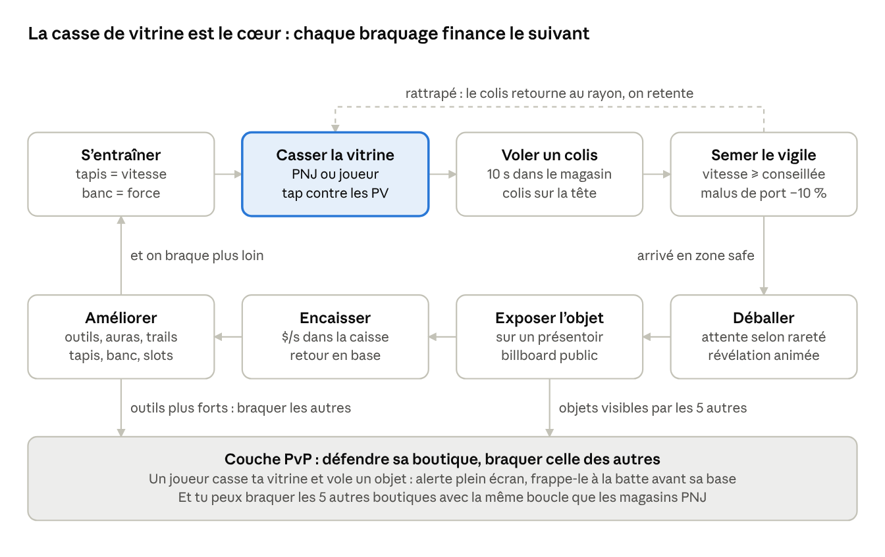
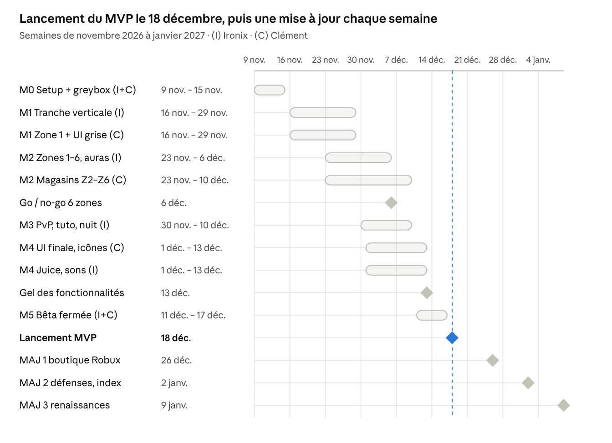

# STEAL A SHOP — Doc de suivi

Nov 6, 2026 · @Clément RONDEPIERRE

Ce doc a deux parties. **Partie 1 · MVP** (ce fichier) : tout ce qui sort au lancement du 18 décembre 2026, plus l'équipe, la tech et la bible assets. **Partie 2 · Features à ajouter** ([Partie 2 · Features à ajouter](Partie-2-Features-a-ajouter.md)) : défenses avancées, écrans d'UI et rétention, une mise à jour par samedi après le lancement.

## 1. Pitch & TL;DR

**Steal a Shop** est un « Steal a … » à 6 joueurs : on casse la vitrine de magasins PNJ, on vole un colis mystère en 10 secondes, on sème le vigile, et l'objet déballé rapporte de l'argent par seconde dans sa propre boutique. Les 5 autres joueurs peuvent braquer cette boutique à leur tour.

**La boucle en une phrase** : s'entraîner → casser une vitrine → voler un colis → semer le vigile → déballer → exposer → encaisser → améliorer → braquer plus loin, ou braquer un joueur.

| Élément | Choix |
| --- | --- |
| Genre | Tycoon de parcelle « Steal a … » (référence : Steal an Egg) + braquage |
| Joueurs par serveur | 6, une parcelle-boutique chacun |
| Plateforme prioritaire | Mobile d'abord : tap sur la vitre, UI au pouce, perf sur téléphone d'entrée de gamme |
| Public visé | 9–15 ans, sessions de 15 à 30 min, retour quotidien |
| Lancement visé | MVP public le vendredi 18 décembre 2026 (début des vacances de Noël), puis une mise à jour par semaine |

**Dans le MVP (ce fichier)**

- Zone safe avec les 6 parcelles-boutiques des joueurs.
- Boulevard de 6 zones de magasins PNJ, de plus en plus rares et durs selon la puissance et la vitesse.
- Casse de vitrine, vol de colis, vigile, attente d'ouverture selon la rareté, animation de déballage, présentoirs, caisse.
- Tapis de course (vitesse) et banc de musculation (force), améliorables.
- Boutique d'armes : les outils de casse, des poings à la disqueuse.
- Boutique d'auras : auras (multiplicateur de puissance) et trails (multiplicateur de vitesse).
- Vol entre joueurs à la batte, avec les règles anti-frustration : on défend sa boutique, et on peut faire tomber le colis d'un autre joueur dans le couloir pour le lui prendre.
- Tutoriel de départ.
- UI de base, faite par Clément : HUD, magasins, déballage, alerte de vol, tuto.

**Après le lancement (Partie 2)** : défenses avancées de la boutique (épaisseur de vitre, caméras, agents de sécurité, pièges, rideau), boutique Robux, renaissances, récompenses quotidiennes et hebdomadaires, index d'objets, idées de rétention.

**Ce qui nous différencie du jeu de référence**

1. **La casse** : on ne vole pas en un clic. On tape la vitrine le plus vite possible contre ses PV, puis elle explose en éclats. C'est le moment signature du jeu.
2. **Le colis mystère** : on vole une boîte sans savoir ce qu'elle contient. Le déballage en base est un second pic de plaisir.
3. **La poursuite** : le vigile rend la vitesse concrète. On sent physiquement si on est assez rapide pour la zone.
4. **Le PvP lisible** : chacun voit les vitrines et les $/s des autres. La victime défend à la batte et investit dans des défenses (vitres, caméras, pièges, rideau).

**Règle de propriété intellectuelle** : on reprend la mécanique de genre, jamais les noms, modèles, sons ou UI du jeu de référence. Le titre « Steal a Shop » suit la convention de nommage du genre ; avant publication, vérifier sur Roblox qu'aucun jeu connu ne porte déjà exactement ce nom.

## 2. Équipe & règles de collaboration

Ironix possède tout ce qui s'exécute (code, systèmes, intégration, publication). Clément possède tout ce qui se voit en 3D (map, modèles, textures, rendus). Chaque tâche a un seul propriétaire, même quand l'autre aide.

| Domaine | Propriétaire | Livrable attendu | L'autre fournit |
| --- | --- | --- | --- |
| Code Luau serveur + client | Ironix | Scripts dans Git, synchronisés par Script Sync | — |
| Greybox de la map (blocs) | Ironix | Map jouable en blocs gris, distances finales | Clément valide les volumes |
| Map finale, parcelles, magasins PNJ | Clément | Modèles dans Team Create avec les tags et noms du contrat (sections 2.1 et 10.4) | Ironix branche les scripts |
| Objets, colis, outils, batte | Clément | MeshParts nommés + attachments | Ironix fournit la liste et les raretés |
| Vitres pré-fracturées + fissures | Clément | 3 tailles de vitre fracturée + 3 textures de fissure | Ironix code la casse |
| Vigiles | Clément | Accessoires sur rig R15 standard (pas de rig custom) | Ironix code l'IA |
| Animations (joueurs, vigiles, PNJ) | Clément | Objets `Animation` publiés au nom du groupe, avec priorité et marqueurs (contrat 2.4) | Ironix les joue et branche sons et effets sur les marqueurs |
| UI, tous les écrans | Clément | ScreenGuis dans StarterGui, sans aucun script, noms du contrat UI (section 2.2) | Ironix code la logique et les animations d'UI |
| Icônes, auras, trails (visuel) | Clément | Rendus 3D des objets, textures de particules et de trails | Ironix intègre les effets |
| VFX de casse et de déballage | Ironix | Séquences intégrées (sections 5.4 et 5.7) | Clément fait les textures |
| Sons | Ironix | Sélection Creator Store + intégration | — |
| Équilibrage | Ironix | Valeurs dans `Config` | Validation à deux en playtest |
| Page du jeu | Ironix | Description, paramètres, publication | Clément fait l'icône et les miniatures |

Toutes les animations sont faites par Clément, selon le contrat de la section 2.4.

**Outils et emplacements**

- **Places Roblox** : une place DEV (Team Create, on casse ce qu'on veut) et une place PROD (publiée uniquement par Ironix). Les deux appartiennent au groupe Roblox du studio, dont Clément est propriétaire ; Ironix y a un rôle « Dev ».
- **Code** : GitHub + Script Sync de Studio (section 2.1). Un changement validé à deux part directement sur `main`, sans branche ni PR ; avant de pousser, on récupère toujours les derniers commits de l'autre (méthode de la liaison, section 3.4).
- **Sources 3D** : fichiers `.blend` dans un drive partagé, `/Art/<Catégorie>/<Nom>.blend`, export `.fbx` à côté.
- **Livraison d'un modèle** : Clément dépose dans `Workspace/_INBOX_CLEMENT`, passe la tâche en « En revue ». Ironix vérifie le contrat d'intégration, puis range dans `ReplicatedStorage/Assets/<Catégorie>`.
- **Communication** : Discord, un salon par pôle + `#bugs`. Ce doc est la source de vérité : une décision non écrite ici n'existe pas.

**Définition de « fini »**

- **Tâche dev** : marche en test multi-clients (2 joueurs minimum), zéro erreur en sortie, chaque remote validé côté serveur, valeurs dans `Config`, testé dans l'émulateur mobile.
- **Tâche modèle** : budget de triangles, nommage, pivot et attachments conformes à la section 10, testé en jeu à côté d'un perso R15, collisions réglées.

**Rituels**

- **Lundi, 15 min** : on choisit les tâches de la semaine dans les backlogs (sections 12 et 13).
- **Jeudi, 30 min** : playtest à deux, chaque bug devient une ligne de backlog.
- **Dimanche** : chacun met à jour ses statuts dans ce doc.

### 2.1 Travailler à deux sans rien casser

Un dossier de Studio = un seul propriétaire. Le code trouve les choses par tags et par noms convenus, jamais par leur position : Clément peut donc déplacer, refaire ou restyler sans casser le code, et Ironix peut réécrire le code sans toucher au visuel.

| Emplacement dans Studio | Propriétaire | Outil | Règle |
| --- | --- | --- | --- |
| `ServerScriptService/Server`, `StarterPlayerScripts/Client`, `ReplicatedStorage/Shared` | Ironix | Script Sync (fichiers dans Git) | Personne d'autre n'y crée ni n'y modifie rien : la synchro marche dans les deux sens et tout changement part sur le disque d'Ironix |
| `Workspace/Map` | Clément | Team Create | Ironix ne déplace rien, il lit les tags et les attributs |
| `ReplicatedStorage/Assets` (modèles, UI, animations), `ServerStorage/Assets` | Clément, validé par Ironix | Team Create | Modèles finis nommés selon 10.3 et 10.4, animations selon 2.4 |
| `ServerStorage/AnimRigs`, `ServerStorage/RBX_ANIMSAVES` | Clément | Éditeur d'animation | Rigs et brouillons d'animation ; Ironix n'y touche pas |
| `StarterGui` (toute l'UI) | Clément | Team Create | Aucun script dans l'UI ; noms selon le contrat UI (2.2) |
| `Lighting` (ambiance) | Clément | Team Create | Ironix n'y touche pas |
| `Workspace/_INBOX_CLEMENT` | Clément | Team Create | Zone de dépôt, vidée par Ironix après validation |
| `Workspace/_SANDBOX_IRONIX` | Ironix | Team Create | Tests temporaires, jamais publiés |

**Script Sync ne relie que les dossiers de code.** Dans le Studio d'Ironix, chacun des 3 dossiers est relié à son dossier sur disque : `ReplicatedStorage/Shared` et `src/shared`, `ServerScriptService/Server` et `src/server`, `StarterPlayer/StarterPlayerScripts/Client` et `src/client`. La synchro marche dans les deux sens : un script créé ou modifié dans ces dossiers depuis Studio part sur le disque d'Ironix, donc personne d'autre n'y touche. Le reste de la place (map, assets, UI, animations) n'est jamais touché. Seul Ironix synchronise, depuis son PC.

**Noms des fichiers imposés par Script Sync** : `.legacy.luau` = `Script`, `.local.luau` = `LocalScript`, `.luau` = `ModuleScript`. Points d'entrée : `src/server/Main.legacy.luau` et `src/client/Main.local.luau`.

**Tags et attributs plutôt que chemins.** Clément pose les tags avec l'éditeur de tags de Studio (fenêtre Propriétés) et les attributs (`Zone = 3`, `Tier = "Luxe"`). Tags utilisés par le code : `NPCStore`, `PlayerPlot`, `Treadmill`, `Bench`, `WeaponShop`, `AuraShop`, `RobuxShop`, `SafeZone`, `ZoneGate`, `CashPad`, `NightWall`, `NightPatrol`.

**Vérificateur de contrat.** À chaque lancement en Studio, un script d'Ironix contrôle tout le contrat (tags, modèles, UI, animations) et liste ce qui manque dans la sortie, par exemple « UI\_WeaponShop.List.Template.Price introuvable ». Clément lance un test avant chaque livraison : zéro ligne rouge = livrable.

**Le circuit d'une journée**

1. Clément travaille dans la place DEV en Team Create (map, assets, UI).
2. Ironix code en local ; `Script Sync` relie son dossier src à la place DEV, ses scripts arrivent en direct ; lui seul synchronise.
3. Avant de livrer, Clément lance un test, vérifie le vérificateur de contrat et passe la tâche en « En revue ».
4. Le jeudi, playtest à deux sur DEV.
5. Seul Ironix publie de DEV vers PROD, uniquement après un playtest réussi.
6. Sauvegardes : l'historique des versions de la place permet de revenir en arrière ; en plus, export `.rbxl` de DEV chaque dimanche dans le drive.

**Règles d'or**

- Clément n'ouvre jamais les scripts d'Ironix et n'écrit aucun script, sauf de petits scripts d'effets visuels FX\_ dans le décor unique (enseigne, fontaine, lumière), jamais sur les objets répétés ni dans l'UI (liaison, section 3.3). Ironix ne modifie aucun visuel.
- On ne renomme ni ne supprime rien du contrat sans l'annoncer dans `#contrat` et mettre à jour les tableaux 2.2 et 10.4 d'abord.
- Si quelque chose casse : on revient à la version précédente de la place, puis on cherche la cause.

### 2.2 Contrat UI

Clément livre d'abord chaque écran en version grise (bons noms, aucun style) en une journée. Ironix le branche, puis Clément l'habille autant qu'il veut sans rien casser.

- **Un écran = un ScreenGui** dans `StarterGui`, nommé `UI_<Nom>`.
- **Les éléments lus par le code** ont un nom en anglais PascalCase et gardent leur parent. Jamais un nom qui est aussi une propriété Roblox (`Name`, `Text`, `Size`, `Position`, `Visible`, `Parent`) : on écrit `ItemName`, `Label`, etc.
- **Listes** : un élément modèle nommé `Template` (Visible = false) que le code clone.
- **Libre pour Clément** : couleurs, polices, tailles, images, `UIGradient`, `UIStroke`, éléments décoratifs en plus.
- **Libre pour Ironix** : changer les textes, la visibilité, cloner les `Template`, animer à l'ouverture et à la fermeture.
- **Mobile** : tailles en Scale, `UIAspectRatioConstraint`, boutons d'au moins 44 px de haut sur téléphone, rien d'important dans le haut de l'écran (boutons Roblox).

| Écran (MVP) | Éléments obligatoires, noms exacts |
| --- | --- |
| `UI_HUD` | `Cash`, `Income`, `Speed`, `Strength`, `Damage` (TextLabels), `HeistTimer` (TextLabel), `NightCountdown` (TextLabel), `GuardMeter` (Frame avec un enfant `Fill`), `ReturnBaseButton`, `RobuxShopButton` (caché jusqu'à la MAJ 1) |
| `UI_WeaponShop` | `CloseButton`, `List` (ScrollingFrame), `List.Template` avec `Icon`, `ItemName`, `Power`, `Price`, `BuyButton`, `EquipButton` |
| `UI_AuraShop` | `CloseButton`, `Tabs.AurasTab`, `Tabs.TrailsTab`, `List`, `List.Template` avec `Icon`, `ItemName`, `Bonus`, `Price`, `BuyButton`, `EquipButton` |
| `UI_Unbox` | `Rarity`, `ItemName`, `Income` (TextLabels), `ContinueButton` |
| `UI_TheftAlert` | `Banner`, `ThiefName`, `ItemName`, `Arrow` (ImageLabel) |
| `UI_Tutorial` | `Bubble` avec `Label`, `NextButton` |
| `UI_Notify` | `Template` avec `Icon`, `Label` |

Les éléments au-dessus des objets du monde sont des BillboardGui modèles rangés dans `ReplicatedStorage/Assets/UI` : `BB_WindowHP` (`Fill`, `Label`), `BB_OpenTimer` (`Label`), `BB_Item` (`ItemName`, `Rarity`, `Income`) et `BB_Carry` (`ItemName`, `Rarity`, `Income`), l'étiquette au-dessus de la tête de celui qui porte un colis ou un objet volé (section 5.6), et `BB_Box` (`Category`, `Rarity`, `Mutation`), l'étiquette au-dessus de chaque colis, sur le rayon comme porté (décision du 2026-11-07).

### 2.3 Références à envoyer

La priorité va aux références de l'animation d'ouverture, de la casse de vitrine et du style visuel : elles débloquent les premières tâches de Clément et le juice d'Ironix. Collez les liens (YouTube, TikTok, captures dans le drive) dans la colonne Liens ; les specs des sections citées seront ajustées d'après elles.

| Élément | Ce qu'on cherche | Sert à | Liens | Envoyé par |
| --- | --- | --- | --- | --- |
| Animation d'ouverture | 2 à 3 vidéos d'ouvertures qui donnent envie (Roblox, jeux mobiles, unboxings) : montée de tension, explosion de lumière, révélation | Storyboard 5.7 |  |  |
| Casse de vitrine | Verre qui éclate au ralenti, jeux où casser est jouissif | Séquence 5.4, MOD-010 |  |  |
| Style visuel général | 3 à 5 captures de jeux dont vous aimez les couleurs, les matières et la lumière | Planche de style MOD-002 | Captures 1, 3, 4 et 6 sous le tableau (map en mode studs) | Clément |
| Objets exposés | Objets cartoon low-poly au niveau de détail voulu | Catalogue 10.5 |  |  |
| Magasins PNJ et boulevard | Façades de supérette, magasin de jouets, électronique, bijouterie, galerie, banque | MOD-012 à MOD-022 |  |  |
| Parcelle-boutique du joueur | À quoi ressemble « ma boutique » au départ | MOD-015 |  |  |
| Vigiles | Look des agents selon la zone, du gilet de supérette à l'agent de banque | MOD-017 |  |  |
| UI | 3 jeux dont l'UI vous plaît (HUD, boutiques, popups), sur téléphone de préférence | Contrat 2.2 | Captures 1, 2 et 5 sous le tableau (HUD, boutiques) | Clément |
| Auras et trails | Auras et trails de simulateurs Roblox qui donnent envie de les acheter | Section 5.10 |  |  |
| Alerte de vol | Alertes plein écran percutantes | Section 6.2 |  |  |
| Sons | Verre, caisse enregistreuse, sirène, ouverture de colis | DEV-051 |  |  |
| Icône et miniatures | Icônes de jeux du genre qui donnent envie de cliquer | MOD-043 |  |  |

**Références reçues le 2026-11-06 (Clément)** : une map en « mode studs » (sol vert en damier avec des studs, arbres en blocs, clôtures en bois, route grise, falaises en damier ocre) et une UI à gros boutons saturés cernés de noir, texte blanc contouré, panneaux violet nuit à bordure dorée. Elles servent à la planche de style (MOD-002, section 10.6). Les 6 captures sont affichées dans le doc partagé ; une copie est dans le dossier d'art de Clément (`References/2026-11-06_Studs`).

1. Plateau et HUD
2. Boutique : panneau violet, bordure dorée, onglets
3. Allée en damier, route, clôtures
4. Arbres en blocs, stands, boutons du HUD
5. Boutique d'œufs : cadres par rareté, arc-en-ciel au sommet
6. Couloir entre falaises en damier

### 2.4 Contrat d'animations

Clément fait toutes les animations (joueurs, vigiles, PNJ) ; Ironix décide quand elles se jouent. Ils se retrouvent sur un nom, jamais sur un timing en secondes. Ce contrat reprend la proposition d'Ironix (fichier « Liaison code ↔ visuel » du dépôt, section 3.2), validée par Clément le 6 novembre 2026, et la complète avec les marqueurs, les priorités, les boucles et 7 animations.

- **Outil** : éditeur d'animation de Studio, sur un rig R15 standard. Une animation complexe peut se faire dans Blender sur un rig R15, puis s'importer en FBX dans l'éditeur.
- **Où** : un dossier `Animations` d'objets `Animation`. Pour un modèle animé (vigile, vigile de nuit, vendeur), dans le modèle lui-même : `<Modèle>/Animations/<Nom>`. Pour le joueur : `ReplicatedStorage/Assets/Animations/Player/<Nom>`. Rigs de travail dans `ServerStorage/AnimRigs`, brouillons de l'éditeur dans `ServerStorage/RBX_ANIMSAVES`.
- **Publication** : au nom du groupe Roblox du studio, propriétaire du jeu (décidé le 6 novembre 2026), par Clément ou par Ironix. Une animation publiée sur un compte perso ne se joue pas dans le jeu (personnage figé, « Failed to load animation » dans la sortie).
- **Mettre à jour** : remplacer l'`AnimationId` de l'objet existant. Ne jamais supprimer ni renommer l'objet : le code ne le retrouverait plus.
- **Côté code** : Ironix cherche l'objet `Animation` par son nom, jamais un ID écrit dans le code, et accroche sons et effets aux marqueurs. Il ne retouche jamais une animation ; si le rythme ne va pas, il le demande.
- **Réglé par Clément** : la priorité, la boucle et les marqueurs du tableau ci-dessous, posés sur l'image clé concernée. `CarryIdle` et `CarryRun` n'animent que le haut du corps, en priorité Action, pour se mélanger à la marche.
- **Registre** : chaque animation publiée est notée dans le registre du fichier « Liaison code ↔ visuel » (nom, emplacement, ID) ; Ironix y coche « Branchée » quand le code la joue.
- **Objets Légendaires** : leurs petites animations (rotation, rebond) se font en code ; Clément prépare seulement des pièces séparées.

20 animations : 13 pour le joueur, 5 dans chaque modèle de vigile (jour et nuit, mêmes noms), 2 dans chaque vendeur.

| Pour | Nom | Quand | Boucle | Priorité | Marqueur | Proposé par |
| --- | --- | --- | --- | --- | --- | --- |
| Joueur | `HitWindow` | Coup sur une vitrine, des poings au pied-de-biche | Non | Action | `Impact` | Ironix |
| Joueur | `HitWindowHeavy` | Coup sur une vitrine, du marteau à la disqueuse | Non | Action | `Impact` | Ajout |
| Joueur | `Grab` | Prise d'un colis sur un rayon ou au sol | Non | Action | `Grab` | Ajout |
| Joueur | `CarryIdle` | Colis au-dessus de la tête, à l'arrêt, bras seuls | Oui | Action | — | Ironix |
| Joueur | `CarryRun` | Colis au-dessus de la tête, en courant, bras seuls | Oui | Action | — | Ironix |
| Joueur | `Place` | Poser un colis sur l'établi | Non | Action | `Release` | Ajout |
| Joueur | `TreadmillRun` | Course sur le tapis | Oui | Movement | — | Ironix |
| Joueur | `BenchLift` | Une répétition au banc | Non | Action | `Top` | Ironix |
| Joueur | `Unbox` | Ouvrir un colis | Non | Action | `Open` | Ajout |
| Joueur | `Celebrate` | Objet Légendaire ou mieux révélé | Non | Action | — | Ajout |
| Joueur | `SwingBat` | Coup de batte | Non | Action | `Impact` | Ironix |
| Joueur | `Stunned` | Étourdi pendant 2 s | Oui | Action | — | Ironix |
| Joueur | `Knockback` | Projeté par un coup | Non | Action | `Land` | Ironix |
| Vigile, jour et nuit | `Idle` | En attente | Oui | Idle | — | Ironix |
| Vigile, jour et nuit | `Walk` | Ronde ; le vigile de nuit tient sa lampe torche | Oui | Movement | — | Ironix |
| Vigile, jour et nuit | `Run` | Poursuite | Oui | Movement | — | Ironix |
| Vigile, jour et nuit | `Catch` | Le coup qui projette le joueur | Non | Action | `Impact` | Ironix |
| Vigile, jour et nuit | `Tired` | Retour essoufflé | Non | Action | — | Ironix |
| Vendeur | `Idle` | Derrière son comptoir | Oui | Idle | — | Ajout |
| Vendeur | `Wave` | Salue quand on approche | Non | Action | — | Ajout |

**Tâches d'animation**

| ID | Tâche | Fini quand… | Qui | Jalon | Prio | Statut |
| --- | --- | --- | --- | --- | --- | --- |
| ANI-001 | Rig R15 de travail + une animation test publiée au nom du groupe | L'animation test se joue dans la place DEV et figure dans le registre de la liaison | Clément | M0 | P0 | Fait |
| DEV-006 | Chargement des animations par leur nom (dossiers `Animations` des modèles et `Assets/Animations/Player`), préchargement, écoute des marqueurs ; le ContractChecker vérifie les 20 noms | L'animation test se lance et son marqueur déclenche un son | Ironix | M0 | P0 | À faire |
| ANI-010 | Braquage : `HitWindow`, `HitWindowHeavy`, `Grab`, `CarryIdle`, `CarryRun`, `Place` | Marqueurs posés, colis fluide à l'arrêt comme en courant | Clément | M1 | P0 | À faire |
| ANI-011 | Base : `TreadmillRun`, `BenchLift`, `Unbox` | Synchronisées avec le tapis, le banc et le couvercle du colis | Clément | M1 | P0 | À faire |
| ANI-012 | Vigile de jour : `Idle`, `Walk`, `Run`, `Catch`, `Tired` | Lisibles de loin, l'essoufflement fait sourire | Clément | M1 | P0 | À faire |
| ANI-020 | PvP : `SwingBat`, `Stunned`, `Knockback` | Le coup se lit en une demi-seconde | Clément | M3 | P0 | À faire |
| ANI-021 | Vigile de nuit (mêmes 5 noms, avec lampe torche) + vendeurs `Idle` et `Wave` | Lampe tenue dans toutes les poses | Clément | M3 | P1 | À faire |
| ANI-030 | `Celebrate` + passe de finition sur toutes les animations | Validé en playtest à deux | Clément | M4 | P1 | À faire |

## 3. Boucle de jeu



*boucle de jeu · 8 étapes, 1 échec, couche PvP*

Un braquage complet dure environ 30 s en zone 1 et 1 min en zone 6 ; l'attente d'ouverture tourne pendant qu'on repart. La casse est en couleur parce que c'est le moment signature : c'est là qu'on met le plus de soin.

**Les 10 premières minutes** (onboarding sans mur de texte, uniquement des flèches et des objectifs)

1. **0:00** : arrivée sur sa parcelle (stand vide). Flèche au sol vers la Supérette, à 60 studs.
2. **0:15** : premiers coups aux poings sur la vitre (35 PV). Fissures et son qui monte.
3. **0:25** : casse + chrono de 10 s. Le premier colis est forcément Premium, le vigile du tuto est lent.
4. **0:45** : retour en zone safe, colis posé sur l'établi. Attente raccourcie à 5 s, puis l'animation d'ouverture complète : objet Rare garanti.
5. **1:00** : objet posé sur un présentoir, son billboard affiche 5 $/s. Premier encaissement.
6. **2:00** : le tapis et le banc s'allument, 30 s d'entraînement guidé.
7. **3:00** : assez d'argent pour la clé à molette (300 $), flèche vers la boutique d'armes.
8. **4:00** : flèche vers la boutique d'auras ; la première aura coûte 500 $.
9. **5:00** : objectif affiché, la zone 2 (vitesse conseillée 22, dégâts conseillés 10).
10. **10:00** : fin du bouclier débutant. Message « Ta boutique est maintenant braquable : garde ta batte à portée ».

## 4. Carte & zones

La map est une seule rue droite : la zone safe (6 parcelles) au départ, puis 6 zones de magasins de plus en plus loin. Plus la zone est loin, plus le retour est long : c'est ce qui rend la vitesse indispensable. Les 6 zones (12 magasins) font toutes partie du MVP.

**Layout**

- **Zone safe** : carré de 240 × 240 studs. 6 parcelles de 64 × 80 studs, 3 de chaque côté d'une allée centrale de 60 studs. De porte à porte : 80 studs minimum (face à face), environ 180 studs maximum (diagonale).
- **Dans la zone safe** : spawn au centre de l'allée, les 3 boutiques d'achat (armes, auras, Robux) et le receleur à l'entrée de l'allée, panneaux de classement.
- **Limite safe** : arche « ZONE SAFE » + ligne au sol, une seule sortie vers le boulevard. Les vigiles PNJ ne la franchissent jamais. Le PvP reste possible entre parcelles.
- **Boulevard** : 40 studs de large, un magasin PNJ de chaque côté par zone (12 magasins au total). Rue droite : depuis la zone safe on voit les magasins lointains, c'est l'objectif sous les yeux.
- **Arche de zone** : à l'entrée de chaque zone, « Zone 3 · Vitesse conseillée 28 · Dégâts conseillés 80 ».

**Lobby volontairement simple au MVP** : une zone safe plate avec les 6 parcelles et un couloir droit, comme dans le jeu de référence. À l'entrée du couloir se trouve le mur de nuit (section 5.12). La transformation en grand centre commercial est une feature de la Partie 2, section 6 de [Partie 2 · Features à ajouter](Partie-2-Features-a-ajouter.md).

| Zone | Magasins PNJ | PV vitre | Dégâts/coup conseillés | Vitesse conseillée (WalkSpeed) | Vitesse du vigile | Distance de retour (studs) | Revenu de base ($/s, Commun) | Jalon |
| --- | --- | --- | --- | --- | --- | --- | --- | --- |
| 1 | Supérette, Kiosque | 35 | 1 | 16 | 13,4 | 60 | 1 | MVP |
| 2 | Magasin de jouets, Confiserie | 350 | 10 | 22 | 18,8 | 140 | 8 | MVP |
| 3 | Électronique, Jeux vidéo | 2 800 | 80 | 28 | 24,2 | 240 | 60 | MVP |
| 4 | Bijouterie, Horlogerie | 21 000 | 600 | 34 | 29,6 | 360 | 450 | MVP |
| 5 | Galerie d'art, Antiquaire | 175 000 | 5 000 | 40 | 35 | 500 | 3 500 | MVP |
| 6 | Banque, Salle des coffres | 1 400 000 | 40 000 | 48 | 42,2 | 660 | 25 000 | MVP |

**D'où viennent ces chiffres** (valeurs V0, toutes dans `Config/Zones`) :

- **PV vitre = 35 × dégâts conseillés** : à 7 coups/s et avec la régénération de 3 % des PV/s, la vitre casse en 6 s environ.
- **Vitesse du vigile = 0,9 × vitesse conseillée − 1** : à la vitesse conseillée, on le distance même avec le malus de portage (−10 %). Un peu en dessous, on s'en sort parfois : c'est voulu.
- **Retour à vitesse conseillée** : 4 s en zone 1, 15 s en zone 6.

## 5. Systèmes de jeu détaillés

Chaque système donne sa règle et ses valeurs V0 ; les formules d'économie sont regroupées en section 7, le PvP en section 6.

### 5.1 Stats et entraînement

Deux stats permanentes, entraînées dans sa propre parcelle.

| Stat | Machine | Gain | Effet en jeu |
| --- | --- | --- | --- |
| Vitesse | Tapis de course | +1 par seconde × multiplicateur du tapis | WalkSpeed = 16 + Vitesse × 0,05 × multiplicateur du trail, plafonné à 70 |
| Force | Banc de musculation | +1 par répétition (1 tap, 3 rép/s max) × multiplicateur du banc | Dégâts × (1 + Force / 100) |

- **Tapis** : invite « Courir », le perso est placé sur le tapis, animation de course, la bande défile. AFK autorisé (bon pour le temps de jeu) ; taper l'écran donne +50 % de gain.
- **Banc** : invite « Soulever », une répétition animée par tap, chiffre flottant « +1 Force ».
- **Plafond de 70** : au-delà, collisions et caméra deviennent instables sur Roblox.
- **Cible d'équilibrage** : passer d'une zone à la suivante demande environ 5 min d'entraînement et 5 min de revenus.

### 5.2 Outils et dégâts

- **Hotbar** : slot 1 = outil de casse équipé, slot 2 = batte. On garde tous les outils achetés, on en équipe un.
- **Coup** : 1 tap = 1 coup, portée 8 studs. Plafond serveur de 10 coups/s : les autoclickers sont tolérés mais pas avantagés au-delà.
- **Réactivité** : le client joue tout de suite l'animation, le son et les mini-éclats. Le serveur valide, applique les PV et les renvoie à tous.
- Formule des dégâts et table des outils : section 7.

### 5.3 Braquer un magasin PNJ

1. **Approche** : un panneau au-dessus de la vitrine affiche nom, PV, dégâts et vitesse conseillés. Chiffres verts si le joueur les atteint, orange entre 50 et 99 %, rouges en dessous.
2. **Frappe** : barre de PV au-dessus de la vitre, régénération continue de 3 % des PV max par seconde, fissures visibles à 75, 50 et 25 %.
3. **Casse** : à 0 PV, séquence de casse (5.4) et chrono de 10 s affiché en grand.
4. **Pillage** : 10 colis par magasin. 6 Standard sur les rayons avant (prise en 0,3 s), 3 Premium au milieu (0,6 s), 1 Luxe dans la réserve du fond (1,0 s). Un seul colis porté à la fois.
5. **Fuite** : dès qu'un colis est soulevé, le vigile sort de la réserve (5.5). Le chrono ne compte plus pour ce joueur.
6. **Fermeture** : à 10 s, le rideau métallique tombe. Les joueurs encore dedans sans colis sont éjectés devant l'entrée.
7. **Reconstruction** : la vitrine se reconstruit 20 s après la fermeture, mais les colis pris ne reviennent pas : les rayons ne se remplissent qu'à la nuit (section 5.12). Les magasins se vident donc au fil de la journée.
8. **Multijoueur (proposition, à valider en section 15)** : la vitrine est partagée. Une fois cassée, tout le monde peut entrer pendant les 10 s ; le casseur a 1 s d'avance exclusive.

### 5.4 Le moment de la casse

C'est la séquence des miniatures et des vidéos : priorité absolue en qualité.

- **Pendant les coups** : son de verre dont la hauteur monte quand les PV baissent, léger tremblement caméra, chiffre de dégâts flottant, mini-éclats au point d'impact, fissures progressives.
- **À la casse** : arrêt sur image de 60 ms, flash blanc de 80 ms, tremblement caméra de 0,25 s, texte « CASSÉ ! ».
- **Les éclats** : la vitre intacte disparaît, la version pré-fracturée (30 à 40 éclats) apparaît à sa place. Chaque éclat part depuis le point d'impact avec une rotation aléatoire, rebondit au sol, puis s'efface en 1,2 s après 1,5 s.
- **Le son** : 3 couches (impact sourd, éclatement, cliquetis des morceaux qui retombent), hauteur variable de ±10 %.
- **Particules** : paillettes de verre + poussière.
- **Technique** : tout est simulé côté client ; le serveur envoie seulement « vitrine X cassée au point P ». Les éclats ignorent les joueurs (groupe de collision). Version à 10 éclats sur mobile faible ou au-delà de 2 casses simultanées.

### 5.5 Le vigile et la poursuite

- **Apparition** : à la porte de la réserve, au moment où un colis est soulevé. Un vigile par voleur, 3 max par magasin.
- **Vitesse** : table de la section 4.
- **IA** : course directe si ligne de vue, sinon PathfindingService recalculé toutes les 0,3 s. Le serveur possède la physique du vigile.
- **Capture** : distance ≤ 4 studs, vérifiée côté serveur. Le colis revole vers son rayon, le joueur est étourdi 1,5 s, message « Rattrapé ! Vitesse conseillée : 28 ».
- **Abandon** : le joueur passe l'arche safe, ou 20 s de poursuite, ou 120 studs d'avance. Le vigile rentre en marchant, essoufflé.
- **Tension** : jauge de distance vigile/joueur au bord de l'écran, battements de cœur sous 10 studs.
- **Visuel** : un look par zone (gilet de supérette jusqu'à agent de banque), mêmes scripts.
- **P1** : comportements par zone (chien en zone 4, taser à distance en zone 6).

### 5.6 Porter un colis

- **Sur la tête** : le colis volé à un PNJ, ou l'objet volé à un joueur, flotte au-dessus de la tête (`CarryAttachment` soudé à la tête, sans masse).
- **Rareté affichée** : sur le rayon, on ne voit que le type de colis. Dès qu'on le soulève, sa rareté se révèle : la boîte prend la couleur de la rareté, le halo de rareté l'entoure et l'étiquette `BB_Carry` affiche par exemple « LÉGENDAIRE ». L'objet exact reste caché jusqu'à l'ouverture.
- **Objet volé à un joueur** : c'est l'objet lui-même qui flotte, avec son halo, son nom, sa rareté et son $/s.
- **Halo de rareté** (l'aura de l'objet, à ne pas confondre avec les auras portées par le joueur) : particules et lumière de la couleur de la rareté, plus denses à chaque palier. Commun : aucun. Peu commun : léger. Rare et Épique : net. Légendaire et Mythique : rayons. Secret : arc-en-ciel animé. Le même halo entoure l'objet sur son présentoir.
- **Tout le monde le voit** : un colis Légendaire qui traverse la rue se repère de loin, ce qui rend la fuite plus tendue et attire les autres joueurs.
- **Malus de vitesse** : −10 % pour un colis PNJ, −25 % pour un objet volé à un joueur. Saut autorisé. Impossible d'équiper un outil ou la batte.
- **Échec** : mort, déconnexion ou anomalie anti-triche, le colis ou l'objet retourne d'où il vient.
- **Coup de batte d'un autre joueur** (hors zone safe) : le colis PNJ tombe au sol et devient ramassable par tous (6.2).
- **Arrivée** : un colis PNJ se pose sur un établi d'ouverture ; un objet volé à un joueur s'expose tout de suite.

### 5.7 Attente d'ouverture et révélation

Un colis volé à un magasin PNJ attend avant de s'ouvrir, d'autant plus longtemps que l'objet est rare (de 10 s pour un Commun à 15 min pour un Secret, table 7.3). Un objet volé à un joueur arrive directement, sans attente (section 6.1).

- **Contenu tiré au vol** par le serveur et stocké dans la sauvegarde. La rareté est connue dès qu'on soulève le colis (5.6) et fixe l'attente ; l'objet exact reste une surprise jusqu'à l'ouverture.
- **Minuteur visible** au-dessus du colis sur l'établi (`BB_OpenTimer`). Il continue hors ligne (horodatage serveur).
- **Les colis en attente ne sont pas volables** : en PvP, on ne vole que des objets exposés.
- **Accélérer** : produit « Ouvrir maintenant » de la boutique Robux (Partie 2, MAJ 1).

**Storyboard de la révélation** (V0, à affiner avec les vidéos de la section 2.3). Version complète pour Rare et plus, environ 4 s jusqu'à l'objet :

1. **Prêt** : l'attente finie, le colis brille et rebondit sur l'établi avec un « ding », bouton « Ouvrir » dessus. Le joueur déclenche le moment quand il veut.
2. **Tension (0 à 1,5 s)** : la caméra glisse vers le colis en cadrage serré, le reste de l'écran s'assombrit, le colis tremble de plus en plus fort, le son monte.
3. **Indice (1,5 à 2,2 s)** : des rayons de lumière filtrent par les fentes du carton, dans la couleur de la rareté. Plus la rareté est haute, plus les rayons sont nombreux et le son grave.
4. **Explosion (2,2 s)** : le couvercle saute en tournant, flash blanc de 100 ms, onde de choc, paillettes et confettis aux couleurs de la rareté, coup de basse.
5. **Révélation (2,2 à 4 s)** : l'objet monte en tournant lentement dans un halo, rayons tournants derrière lui. L'écran `UI_Unbox` affiche la rareté en grand, le nom, puis le $/s qui défile jusqu'à sa valeur.
6. **Célébration** : Épique et plus, confettis plein écran. Légendaire et plus, annonce à tout le serveur. Secret, ralenti de 0,5 s, musique unique et arc-en-ciel.
7. **Retour** : « Continuer », l'objet vole jusqu'au présentoir libre le plus proche (dans les mains si tout est plein) et la caméra revient au joueur.

- **Version courte** (Commun, Peu commun) : étapes 2 à 5 condensées en 2 s, sans assombrissement, pour ne pas lasser.
- **Technique** : caméra et effets côté client. Le serveur n'envoie l'identité de l'objet qu'au moment où le joueur appuie sur « Ouvrir », jamais avant.
- **Assets** : colis avec couvercle séparé (MOD-013), textures de rayons, paillettes et confettis (MOD-041), une couleur par rareté.

### 5.8 Présentoirs, revenus et caisse

- **Présentoirs** : 4 au départ, +1 par amélioration, 20 max en V1. Chaque objet exposé rapporte son revenu en $/s.
- **Billboard** au-dessus de chaque objet, visible par tous : nom, rareté (couleur), $/s. C'est ce qui attire les voleurs.
- **Caisse** : l'argent produit s'accumule dans la caisse. Le joueur marche sur le tapis de caisse pour encaisser, ce qui le ramène en base, donc en défense.
- L'argent en caisse n'est **pas volable** : seuls les objets et les colis le sont.
- **Inventaire** : 30 objets non exposés maximum. Le receleur rachète un objet 120 × son $/s.

### 5.9 Les 3 boutiques d'achat

Le jeu a trois boutiques : armes et auras s'achètent avec l'argent du jeu dès le MVP, la boutique Robux arrive avec la MAJ 1.

| Boutique | Ce qu'on y achète | Monnaie | Où | Écran | Quand |
| --- | --- | --- | --- | --- | --- |
| Boutique d'armes | Outils de casse, des poings à la disqueuse (table 7.2) | Argent du jeu | Zone safe, entrée de l'allée, à gauche | `UI_WeaponShop` | MVP |
| Boutique d'auras | Auras (puissance) et trails (vitesse) (table 7.4) | Argent du jeu | Zone safe, entrée de l'allée, à droite | `UI_AuraShop` | MVP |
| Boutique Robux | Gamepasses, packs d'argent, boosts (Partie 2, section 4) | Robux | Bouton du HUD + comptoir doré en zone safe | `UI_RobuxShop` | MAJ 1 |

Les boutiques d'armes et d'auras s'ouvrent en s'approchant de leur comptoir, avec un PNJ vendeur : on doit revenir en zone safe pour dépenser son argent. Seule la boutique Robux s'ouvre aussi depuis le HUD, partout.

- **Receleur** : ce n'est pas une boutique d'achat. Il rachète les objets (120 × leur $/s) et ses répliques donnent le ton humoristique du jeu.

### 5.10 Boutique d'auras et de trails

Les auras multiplient la puissance, les trails multiplient la vitesse. Elles s'achètent avec l'argent du jeu et se voient sur le personnage : les autres joueurs lisent ton niveau d'un coup d'œil.

- **Achat** : à la boutique d'auras, écran `UI_AuraShop` avec 2 onglets. Prix et multiplicateurs : section 7.4.
- **Équipement** : une aura et un trail à la fois ; on garde tout ce qu'on a acheté.
- **Aura** : particules et lumière autour du perso, plus spectaculaire à chaque palier.
- **Trail** : traînée derrière le perso, surtout visible en courant.
- **Partage du travail** : Clément fait les textures et les couleurs, Ironix les effets et leur intégration.
- **Performance** : les auras des autres joueurs perdent la moitié de leurs particules au-delà de 60 studs.

### 5.11 Tutoriel de départ

- **Déroulé** : minute par minute en section 3.
- **Guidage** : flèche au sol + bulle courte (`UI_Tutorial`), 8 mots maximum par bulle, jamais de mur de texte.
- **Résultats garantis** : 1er colis Premium, vigile lent (vitesse 12), attente de 5 s, objet Rare.
- **Reprise** : l'étape est sauvegardée ; un joueur qui part au milieu reprend au même endroit.
- **Mesure** : chaque étape est une étape du funnel (section 14.2), pour voir où les joueurs décrochent.
- **Passer** : bouton disponible à partir de l'étape 5, pour ceux qui connaissent déjà le genre.

### 5.12 Cycle jour / nuit

Toutes les 10 minutes, la nuit tombe pendant 2 minutes : le couloir se ferme, les vigiles de nuit patrouillent et les rayons de tous les magasins PNJ se remplissent. À l'aube, tout le monde se rue sur des magasins pleins.

| Phase | Durée V0 | Ce qui se passe |
| --- | --- | --- |
| Jour | 8 min | Magasins ouverts. Une vitrine cassée se reconstruit en 20 s, mais les colis pris ne reviennent pas avant la nuit. |
| Alerte | 30 dernières secondes du jour | Sirène, ciel qui rougit, compte à rebours en grand « LA NUIT TOMBE DANS 30 S ». Les voleurs dans le couloir doivent vite rentrer. |
| Nuit | 2 min | Un mur géant monte du sol à l'entrée du couloir : plus personne n'y entre. Des vigiles de nuit patrouillent dans tout le couloir. Les rayons de tous les magasins PNJ sont réinitialisés (nouveau tirage). |
| Aube | Instantané | Le mur redescend, toutes les vitrines sont intactes et les rayons pleins : ruée générale. |

- **Mur à sens unique** : il bloque le passage de la zone safe vers le couloir, mais un joueur encore dans le couloir peut le traverser pour rentrer (passage géré par le serveur).
- **Vigiles de nuit** : 2 par zone, en ronde entre des points fixes, avec une lampe torche. Ils repèrent un joueur à 40 studs dans leur cône de lumière, puis courent à la vitesse conseillée de la zone + 4 : seuls les joueurs bien plus rapides que conseillé peuvent les semer.
- **Attrapé la nuit** : le colis porté retourne au magasin, le joueur est renvoyé à sa base et étourdi 2 s. Aucune autre perte.
- **Course en cours** : un joueur qui porte déjà un colis quand la nuit tombe garde sa course ; s'il atteint la zone safe, le colis est à lui.
- **La nuit en zone safe** : on s'entraîne, on ouvre ses colis, on achète, on défend ou on braque les autres joueurs. La nuit relance le PvP.
- **Nouveaux joueurs** : bulle du tuto « La nuit tombe : rentre vite ! ». Pendant leurs 10 premières minutes (bouclier débutant), les vigiles de nuit les ignorent.
- **Technique** : NightCycleService côté serveur, une seule horloge pour tout le serveur, phase envoyée aux clients. Ciel et lumières animés côté client (`Lighting.ClockTime`), lampadaires allumés. Valeurs dans `Config/Night` : durées, nombre de vigiles, vitesse, rayon de détection.
- **Assets (Clément)** : mur géant qui monte du sol (rideau de fer ou briques, 2 états, tag `NightWall`), look des vigiles de nuit (lampe torche, casquette), points de ronde (tag `NightPatrol`), lampadaires avec une partie lumineuse.

## 6. PvP de base

Toute boutique se braque avec la même mécanique que les magasins PNJ. La victime est prévenue en plein écran et récupère son objet si elle frappe le voleur à la batte avant qu'il atteigne sa propre boutique.

**Vitrine d'un joueur au MVP** : PV = 50 × les dégâts par coup de son propriétaire, régénération 3 %/s. Elle grandit donc avec le joueur : un voleur de même niveau met environ 9 s à la casser, un voleur qui fait moins de 21 % de tes dégâts n'y arrive pas. Les défenses achetables arrivent en Partie 2.

### 6.1 Voler un joueur

1. **Repérage** : à 15 studs d'une boutique, un panneau affiche le propriétaire, la valeur exposée (« 12,4 K$/s ») et les PV de la vitrine.
2. **Frappe** : même système que les PNJ (PV, régénération 3 %/s). L'alarme de base prévient la victime quand sa vitrine casse.
3. **Casse** : 10 s pour prendre un objet exposé (prise en 1,0 s). Les colis en attente d'ouverture et le coffre-fort ne sont pas volables.
4. **Fuite** : l'objet flotte au-dessus de la tête du voleur avec son halo de rareté et son étiquette (nom, rareté, $/s), plus un contour rouge visible par tous. Malus de vitesse de −25 % (au lieu de −10 % pour un colis PNJ), car les boutiques sont proches.
5. **Réussite** : le voleur entre dans la zone de dépôt de SA boutique. L'objet est à lui tout de suite, sans attente ni déballage : il peut l'exposer immédiatement et il rapporte aussitôt.
6. **Échec** : coup de batte de la victime, mort ou déconnexion du voleur, ou déconnexion de la victime. L'objet revient à son présentoir d'origine.

### 6.2 La batte : défendre sa boutique et braquer les porteurs

La batte (slot 2) a deux usages, avec le même coup : portée 7 studs, recharge 0,8 s, validé par le serveur, un seul coup réussi suffit. Elle ne frappe jamais en zone safe, sauf le propriétaire contre le voleur de sa boutique.

**Usage 1 · Défendre sa boutique**

- **Alerte** : bannière rouge plein écran « \[Pseudo\] VOLE TON \[Objet\] ! FRAPPE-LE ! », sirène, flèche permanente vers le voleur, voleur surligné à travers les murs.
- **Réaction** : la batte s'équipe automatiquement. Bonus Adrénaline de +25 % de vitesse jusqu'à la fin de la poursuite.
- **Coup** : le voleur est étourdi 2 s, l'objet revole en arc vers son présentoir d'origine.
- **Retour base** : bouton gratuit, recharge 90 s, interdit en portant quelque chose. Il permet de rentrer défendre depuis le boulevard.

**Usage 2 · Braquer un porteur dans le couloir** (comme dans le jeu de référence)

- **Qui** : n'importe quel joueur peut frapper n'importe quel joueur qui porte un colis PNJ, partout hors de la zone safe (boulevard et intérieur des magasins).
- **Effet** : le porteur est projeté (knockback) et étourdi 2 s. Le colis tombe au sol à l'endroit du coup, avec sa couleur, son halo et son étiquette `BB_Carry` : tout le monde voit ce qui est par terre.
- **Colis au sol** : n'importe qui peut le ramasser (prise en 0,5 s, mains vides, comme sur un rayon), le frappeur n'a aucune priorité. Le contenu tiré au vol ne change pas : le nouveau porteur récupère la même rareté et le même objet caché.
- **Abandonné** : au bout de 15 s au sol sans être ramassé, le colis retourne sur son rayon d'origine.
- **Le vigile suit le colis** : s'il était en poursuite, il change de cible et poursuit le nouveau porteur (mêmes règles d'abandon qu'en 5.5).
- **Objet volé à un joueur** : un coup de batte d'un tiers fait tomber le voleur, mais l'objet ne va pas au sol : il revole vers le présentoir de son propriétaire (transfert sûr, 6.4).
- **Valeurs V0** dans `Config/Bat` : durée au sol, temps de prise, durée d'étourdissement, immunité après un coup.

### 6.3 Défenses achetables : en Partie 2

Épaisseur de vitre, caméras de sécurité, agents de sécurité, pièges, rideau et coffres supplémentaires sont décrits en section 2 de [Partie 2 · Features à ajouter](Partie-2-Features-a-ajouter.md).

### 6.4 Règles anti-frustration (non négociables)

Le vol d'objets est le cœur émotionnel du genre, mais aussi la première cause d'abandon le premier jour. Ces règles protègent les nouveaux joueurs.

- **Bouclier débutant** : boutique inviolable pendant les 10 premières minutes de jeu cumulées. Pendant ce temps, les autres joueurs ne peuvent pas non plus faire tomber son colis à la batte.
- **Pas d'acharnement** : après un coup de batte, 3 s d'immunité aux coups de batte, le temps de se relever.
- **Immunité après un vol subi** : 120 s de vitrine invulnérable.
- **Pas de racket** : impossible de voler un joueur dont la valeur exposée est inférieure à 10 % de la tienne.
- **Coffre-fort** : au moins 1 objet est toujours à l'abri.
- **L'argent n'est jamais volé** : seulement les objets et les colis.
- **Transfert sûr** : l'objet ne change de propriétaire qu'au dépôt, avec les deux joueurs connectés. Toute déconnexion annule le vol.

## 7. Économie & équilibrage V0

Toutes les valeurs vivent dans `ReplicatedStorage/Shared/Config` et se règlent sans toucher au code. Cible de rythme : 6 à 8 h de jeu pour atteindre la zone 6. Ce sont des valeurs de départ, ajustées en bêta avec les données de la section 14.

### 7.1 Formules

```latex
\text{Dégâts par coup} = P_{\text{outil}} \times \left(1 + \frac{\text{Force}}{100}\right) \times M_{\text{aura}}
```

```latex
\text{WalkSpeed} = \min\left(70,\; 16 + 0{,}05 \times \text{Vitesse} \times M_{\text{trail}}\right)
```

```latex
\text{Revenu d'un objet (\$/s)} = R_{\text{zone}} \times M_{\text{rareté}} \times M_{\text{global}}
```

```latex
\text{Coût du niveau } n = C_0 \times g^{\,n}
```

- R zone : table de la section 4. M global : bonus cumulés, qui arrivent en Partie 2 (renaissances, gamepasses, groupe, amis).
- Exemple zone 3 : Marteau (20) × Force 100 (×2) × aura Flamme (×2) = 80 dégâts, soit exactement les dégâts conseillés.

### 7.2 Outils de casse

Un outil coûte environ 3 à 7 min de revenus de la zone précédente. Le Marteau-piqueur et le Bélier sont réservés aux renaissances (Partie 2).

| Outil | Puissance | Prix | Zone visée |
| --- | --- | --- | --- |
| Poings | 1 | Gratuit | 1 |
| Clé à molette | 3 | 300 $ | 2 |
| Pied-de-biche | 8 | 8 000 $ | 2–3 |
| Marteau | 20 | 120 K$ | 3 |
| Masse | 50 | 2 M$ | 4 |
| Hache d'incendie | 125 | 30 M$ | 5 |
| Disqueuse | 300 | 400 M$ | 6 |

### 7.3 Raretés, colis et attente d'ouverture

Sur le rayon, la boîte ne montre que son type : Standard = carton brun, Premium = carton bleu scellé, Luxe = caisse en bois cerclée d'or. Dès qu'on la soulève, elle prend la couleur et le halo de sa rareté (5.6). L'attente d'ouverture ne concerne que les colis volés aux PNJ.

| Rareté | Couleur | Multiplicateur de revenu | Attente d'ouverture | Colis Standard | Colis Premium | Colis Luxe |
| --- | --- | --- | --- | --- | --- | --- |
| Commun | Gris | ×1 | 10 s | 70 % | 35 % | 0 % |
| Peu commun | Vert | ×2 | 20 s | 22 % | 35 % | 25 % |
| Rare | Bleu | ×5 | 45 s | 7 % | 20 % | 40 % |
| Épique | Violet | ×15 | 1 min 30 | 1 % | 8 % | 25 % |
| Légendaire | Or | ×50 | 3 min | 0 % | 1,8 % | 8 % |
| Mythique | Rouge | ×200 | 8 min | 0 % | 0,2 % | 1,8 % |
| Secret | Arc-en-ciel animé | ×1 000 | 15 min | 0 % | 0 % | 0,2 % |

### 7.4 Auras et trails

Une aura et un trail équipés à la fois ; acheter le palier suivant ne demande pas d'avoir le précédent.

| Aura | Multiplicateur de puissance | Prix | Zone visée |
| --- | --- | --- | --- |
| Étincelle | ×1,5 | 500 $ | 1–2 |
| Flamme | ×2 | 15 K$ | 2–3 |
| Foudre | ×3 | 400 K$ | 3–4 |
| Plasma | ×5 | 10 M$ | 4–5 |
| Galaxie | ×8 | 250 M$ | 5–6 |
| Royale | ×11 | 3 Md$ | 6 |

| Trail | Multiplicateur de vitesse | Prix | Zone visée |
| --- | --- | --- | --- |
| Poussière | ×1,1 | 300 $ | 1–2 |
| Vent | ×1,25 | 10 K$ | 2–3 |
| Turbo | ×1,4 | 300 K$ | 3–4 |
| Comète | ×1,6 | 8 M$ | 4–5 |
| Hyperespace | ×1,8 | 200 M$ | 5–6 |

### 7.5 Améliorations de base

Le multiplicateur de puissance vient désormais des auras, plus d'une amélioration de base. Défenses et niveaux de boutique : Partie 2.

| Amélioration | Effet par niveau | Niveaux | C0 (1er niveau) | g |
| --- | --- | --- | --- | --- |
| Tapis de course | +0,5 au multiplicateur de gain de vitesse | 20 | 200 $ | 1,9 |
| Banc de musculation | +0,5 au multiplicateur de gain de force | 20 | 200 $ | 1,9 |
| Présentoirs | +1 (de 4 à 20) | 16 | 500 $ | 2,5 |
| Établis d'ouverture | +1 (de 1 à 4) | 3 | 2 000 $ | 12 |

### 7.6 Sources et puits d'argent

- **Sources au MVP** : objets exposés, receleur. La Partie 2 ajoute récompenses, codes et gains hors ligne.
- **Puits au MVP** : outils, auras, trails, tapis, banc, présentoirs, établis. La Partie 2 ajoute défenses et renaissances.
- **Règle** : aucun prix ni gain ne vient du client. Le serveur lit `Config` et calcule tout.

## 8. Monétisation & rétention : en Partie 2

Le MVP sort sans boutique Robux ; elle arrive dès la MAJ 1 du 26 décembre. Boutique, renaissances, récompenses quotidiennes et hebdomadaires, index d'objets et idées de rétention sont décrits dans [Partie 2 · Features à ajouter](Partie-2-Features-a-ajouter.md).

## 9. Spécifications techniques (Ironix)

Le serveur fait autorité sur tout ce qui touche à l'argent, aux PV, aux stats et aux objets ; le client ne fait que demander et afficher.

### 9.1 Stack

- **Langage** : Luau en mode strict (`--!strict`), Script Sync de Studio (à la place de Rojo), GitHub, Wally pour les dépendances.
- **Sauvegarde** : ProfileStore (verrou de session, pas de duplication entre serveurs).
- **Réseau** : RemoteEvent et UnreliableRemoteEvent natifs, tous déclarés dans un module `Net`, avec validation de type et limite de débit par remote.
- **Tests** : mode Studio « Serveur + 2 clients » obligatoire pour toute fonctionnalité PvP.

### 9.2 Arborescence

```text
src/                        (dossier F:\StealAShop\src d'Ironix, relié par Script Sync)
  server/                   -> ServerScriptService/Server
    Main.legacy.luau        (Script : charge les services dans l'ordre)
    Services/
  client/                   -> StarterPlayer/StarterPlayerScripts/Client
    Main.local.luau         (LocalScript)
    Controllers/
  shared/                   -> ReplicatedStorage/Shared
    Config/   Balance, Zones, Tools, Items, Upgrades, Defenses, Products
    Net/      définition de tous les remotes
    Types/
Modeles, UI, animations (Team Create, Clement) -> ReplicatedStorage/Assets/<Categorie>
```

### 9.3 Services serveur

| Service | Responsabilité | Quand |
| --- | --- | --- |
| DataService | Profils ProfileStore, schéma, migrations, sauvegarde | MVP |
| PlotService | Attribution et libération des 6 parcelles, chargement de la boutique sauvegardée | MVP |
| StatsService | Vitesse, Force, WalkSpeed appliqué par le serveur | MVP |
| TrainingService | Tapis et banc : présence, ticks, gains | MVP |
| ToolService | Outils possédés, équipement, calcul des dégâts | MVP |
| CosmeticService | Auras et trails : possession, équipement, multiplicateurs, effets | MVP |
| WindowService | PV, régénération, casse, reconstruction ; commun aux PNJ et aux joueurs | MVP |
| StoreHeistService | Magasins PNJ : chrono de 10 s, rayons, tirage des colis, rideau du magasin | MVP |
| GuardService | Vigiles : apparition, IA, capture, abandon | MVP |
| CarryService | Port d'un colis ou d'un objet, malus, dépôt, retour en cas d'échec, colis au sol après un coup de batte (ramassage, retour au rayon à 15 s) | MVP |
| UnboxService | Établis, attente selon la rareté (horodatée), envoi de l'objet révélé | MVP |
| DisplayService | Présentoirs, revenus par seconde, caisse, encaissement | MVP |
| PvPService | Vol entre joueurs, alerte, batte, protections, transfert d'objet sans attente | MVP |
| ShopService | Achats en argent du jeu : outils, auras, trails, améliorations | MVP |
| TutorialService | Étapes, guidage, résultats garantis, reprise | MVP |
| TelemetryService | Funnel et événements d'économie via AnalyticsService | MVP |
| AntiCheatService | Contrôle des déplacements, journal des anomalies | MVP |
| ContractChecker | Vérifie tags, modèles et UI au lancement, en Studio uniquement (section 2.1) | MVP |
| DefenseService, MonetizationService, RewardService, RebirthService, IndexService | Voir la Partie 2 | Partie 2 |

Contrôleurs client : Input, Hit, Shatter, Carry, Unbox (caméra de révélation), Alert, Tutorial, Sound, Animation (charge les animations par leur nom et écoute leurs marqueurs), et un contrôleur par écran d'UI. Ils ne créent aucune UI : ils récupèrent les ScreenGuis de Clément par leur nom (contrat 2.2), puis remplissent, montrent, cachent et animent.

### 9.4 Remotes

| Remote (client vers serveur) | Données | Le serveur vérifie |
| --- | --- | --- |
| HitWindow | windowId | Outil équipé, distance ≤ 10 studs, ≤ 10 coups/s, vitrine cassable (pas de bouclier ni d'immunité) |
| GrabItem | slotId | Magasin ouvert, joueur dans le volume `Bounds`, mains vides, distance ≤ 8 studs, durée de maintien respectée |
| StealItem | plotIndex, slotIndex | Porte de la boutique cassée depuis moins de 10 s, pas la sienne, mains vides, aucune protection (bouclier débutant, immunité de 120 s, anti-racket), une boutique à soi avec de la place, joueur dans `Bounds` à ≤ 8 studs du présentoir, objet exposé et pas à l'abri (coffre-fort), maintien de 1 s (deux appels), ≤ 5 appels/s (ajouté le 2026-11-08, vol entre joueurs) |
| PlaceBox | benchIndex | Sur sa parcelle, porte un colis, établi libre |
| OpenBox | benchIndex | Attente écoulée (horodatage serveur), joueur sur sa parcelle ; le serveur renvoie alors l'objet révélé |
| PlaceItem | itemUid, slotIndex | Possède l'objet, présentoir débloqué et libre |
| SwingBat | — | Recharge 0,8 s, cible à ≤ 7 studs : soit le voleur de SON objet, soit un porteur de colis PNJ hors zone safe (sans bouclier débutant ni immunité de 3 s) |
| GrabDropped | dropId | Colis au sol, mains vides, distance ≤ 8 studs, durée de maintien respectée, hors zone safe |
| BuyItem | catalogId | Prix lu dans `Config` (outils, auras, trails, améliorations), argent suffisant, prérequis remplis |
| EquipCosmetic | cosmeticId | Possédé, bon type (aura ou trail) |
| TrainTap | — | Joueur sur une machine, ≤ 3 taps/s au banc, ≤ 6 taps/s au tapis |
| ReturnToBase | — | Recharge 90 s, mains vides |
| TutorialSkip | — | Étape 5 ou plus |

L'encaissement passe par le contact serveur avec le tapis de caisse, sans remote. Serveur vers client : WindowHP (non fiable, 10 Hz max), WindowBroken (id, point d'impact), HeistTimer, ChaseState, TheftAlert, BoxReady, UnboxReveal, TutorialStep, Notify. La Partie 2 ajoutera ToggleShutter, ClaimReward et Rebirth.

### 9.5 Schéma de sauvegarde v1

```lua
-- Profil ProfileStore, clé "Player_<UserId>"
{
  Version = 1,
  Cash = 0,
  Stats = { Speed = 0, Strength = 0 },
  Upgrades = { Treadmill = 0, Bench = 0, DisplaySlots = 0, UnboxBenches = 0 },
  Tools = { Owned = { "Fists" }, Equipped = "Fists" },
  Cosmetics = { Auras = {}, Trails = {}, EquippedAura = nil, EquippedTrail = nil },
  Items = {},     -- [uid] = { Id = "Z3_Smartphone", Source = "NPC" ou "PvP", At = 0 }
  Display = {},   -- [slotIndex] = uid
  Vault = {},     -- [1] = uid (1 coffre-fort offert)
  Boxes = {},     -- [benchIndex] = { Tier = "Luxe", Zone = 3, ItemId = "...", Rarity = "Epic", ReadyAt = 0 }
  Tutorial = { Step = 0, Done = false },
  Lifetime = { Heists = 0, Steals = 0, Defenses = 0, PlaySeconds = 0 },
  Purchases = {}, -- [PurchaseId] = true, prêt pour la boutique Robux
  -- Partie 2 : Defenses, Rebirths, Index, Rewards, ajoutés par migration (Version = 2)
}
```

### 9.6 Anti-triche

- **Déplacements** : toutes les 0,25 s, le serveur compare la distance parcourue à la vitesse autorisée × 1,25. 3 anomalies en 5 s : retour à la dernière position valide et colis rendu.
- **Téléport ou noclip en portage** : un saut de plus de 30 studs entre deux contrôles rend le colis ou l'objet.
- **WalkSpeed** : calculé et appliqué par le serveur. Une modification côté client est attrapée par le contrôle de déplacement.
- **Rien de sensible ne vient du client** : ni dégâts, ni prix, ni rareté, ni position de dépôt.
- **Objets uniques** : chaque objet a un uid. Un vol PvP retire l'objet de la victime et l'ajoute au voleur dans la même exécution serveur, les deux profils actifs.
- **ProcessReceipt** : on applique l'achat, on enregistre le `PurchaseId` dans le profil, et seulement ensuite on renvoie `PurchaseGranted`.
- **Pas de bannissement automatique en V1** : on journalise, on corrige, on revoit les cas à la main.

### 9.7 Performance

- StreamingEnabled activé ; parcelles et magasins en `ModelStreamingMode = Atomic`.
- Éclats, particules et révélations : côté client uniquement, nettoyés avec Debris.
- Vigiles : 6 actifs maximum par serveur, états Humanoid inutiles désactivés (nage, escalade).
- PV des vitrines : envoyés en non fiable, 10 fois par seconde maximum.
- Test chaque semaine sur un vrai téléphone Android d'entrée de gamme.

## 10. Bible assets (Clément)

Un modèle est livrable quand il respecte 5 règles : échelle en studs, pivot en bas au centre, budget de triangles, nommage, et les pièces nommées que le code attend (contrat d'intégration, 10.4).

### 10.1 Règles techniques

- **Chaîne d'export** (validée le 2026-11-06, MOD-001) : 1 unité Blender = 1 stud. Un cube de 4 × 4 × 4 exporté en `.fbx` arrive à 4 × 4 × 4 studs, avec sa face avant et son pivot. Réglages validés :
    - **Blender** : unités Métrique, échelle d'unité 1,0. L'origine de l'objet, en bas au centre, devient le pivot dans Studio.
    - **Export FBX** : Objets sélectionnés, type Maillage ; **Échelle (Scale) 0,01** ; Appliquer les échelles (Apply Scalings) : Tout local ; Avant : -Z ; Haut : Y ; Appliquer l'unité coché ; Appliquer la transformation (Apply Transform) décoché ; Lissage : Face ; Appliquer les modificateurs coché.
    - **Pourquoi 0,01** : Blender convertit ses mètres en centimètres à l'export (×100) et Studio lit ce nombre comme des studs. Sans l'échelle 0,01, le cube arrive à 400 studs, que « Appliquer l'unité » soit coché ou non.
    - **Import** : 3D Importer de Studio, réglages par défaut.
    - **Orientation** : la face avant dans Blender (vue de face, côté -Y) devient la face avant dans Roblox (-Z, LookVector) ; le haut reste en haut ; pas d'effet miroir.
    - **Après import** : le 3D Importer laisse les pièces non ancrées, en `CollisionFidelity` Default. La routine de livraison règle `Anchored` et les collisions (règle Collisions ci-dessous).
- **Repères d'échelle** : un perso R15 fait environ 5 studs de haut. Porte = 4 × 7,5 studs. Rayon de 2 studs de profondeur, 3 étages, étagère du haut à 5 studs maximum.
- **Vitrines standard** : 3 tailles réutilisées partout. S = 8 × 6, M = 12 × 7, L = 16 × 8 studs (largeur × hauteur), épaisseur 0,4 stud. Un modèle fracturé par taille.
- **Pivot** : en bas au centre. Face avant tournée vers la rue (ou vers la caméra pour les objets).
- **Collisions** : `CollisionFidelity = Box` par défaut, `Hull` si la forme compte, `CanCollide` désactivé pour le décor de moins d'1 stud.
- **Textures** : 1024² maximum (objets Légendaire et plus, outils), 512² en standard, 256² pour les petits props. Préférer couleurs et matériaux Roblox ; `SurfaceAppearance` (PBR) seulement à partir de Légendaire.
- **Style** : cartoon low-poly, silhouettes exagérées, couleurs saturées. Un objet se reconnaît à 40 studs et en icône de 64 px. Plus c'est rare, plus ça brille : Commun mat, Légendaire doré avec halo, Secret animé.
- **Vigiles** : rig R15 standard + accessoires modélisés (casquette, gilet, badge, matraque cartoon). Pas de rig custom, pas d'arme réaliste.

### 10.2 Budgets de triangles

| Asset | Budget max (triangles) |
| --- | --- |
| Objet exposé, Commun à Épique | 2 000 |
| Objet exposé, Légendaire et plus | 4 000 |
| Colis | 300 |
| Outil de casse ou batte | 1 500 |
| Accessoire de vigile | 1 000 |
| Vitre fracturée (tous éclats) | 1 500 |
| Magasin PNJ, extérieur | 12 000 |
| Magasin PNJ, intérieur avec rayons | 15 000 |
| Parcelle complète au niveau max | 25 000 |
| Tapis ou banc | 3 000 |
| Prop de décor (lampadaire, voiture, arbre) | 1 500 |

### 10.3 Nommage

Format : `PREFIXE_Zone-ou-Categorie_Nom_Variante`, en PascalCase, sans accents ni espaces.

| Préfixe | Pour | Exemple |
| --- | --- | --- |
| ITM | Objet exposé | `ITM_Z3_Smartphone` |
| BOX | Colis | `BOX_Luxe` |
| TOOL | Outil de casse | `TOOL_PiedDeBiche` |
| STORE | Magasin PNJ | `STORE_Z1_Superette` |
| PLOT | Parcelle et boutique | `PLOT_Shop_L2` |
| WIN | Vitre intacte ou fracturée | `WIN_M_Fractured` |
| ACC | Accessoire de vigile | `ACC_Z1_Casquette` |
| ENV | Décor | `ENV_Lampadaire_A` |
| FX | Texture de particule | `FX_GlassSparkle` |
| ICON | Icône d'objet : Decal dans `ReplicatedStorage/Assets/Icons` (liaison L-055) | `ICON_Z3_Smartphone` |
| MUS | Musique de fond : Sound en boucle dans `ReplicatedStorage/Assets/Music` (liaison L-056) | `MUS_Z1` |

### 10.4 Contrat d'intégration

Ces noms sont lus par le code : un nom faux = une fonctionnalité qui ne marche pas.

| Modèle | Enfants obligatoires (noms exacts) |
| --- | --- |
| Magasin PNJ `STORE_*` | `Window` (vitre intacte), `WindowFractured` (Model, éclats `Shard_01` à `Shard_40`), `Shutter` (rideau en position ouverte), `Door`, `Bounds` (Part invisible = volume intérieur), `ShelfSlot_01` à `ShelfSlot_10` (Attachments avec attribut `Tier` = Standard, Premium ou Luxe), `GuardSpawn` (Attachment), `SignPart` (support du panneau) |
| Parcelle `PLOT_*` | `Window`, `WindowFractured`, `Shutter`, `ShutterButton`, `DisplaySlot_01` à `_20`, `VaultSlot_01` à `_03`, `UnboxBench_01` à `_04`, `TrapSlot_01` à `_04` (Attachments), `CashPad`, `DepositZone` (Part), `Treadmill`, `Bench`, `NameSign`, `Bounds` |
| Objet `ITM_*` | PrimaryPart nommé `Root` (pivot base centre), attribut `ItemId`, aucun script |
| Colis `BOX_*` | `CarryAttachment` (dessous, au centre), `Lid` (couvercle séparé pour l'animation), Tint (pièce recolorée selon la rareté) |
| Outil `TOOL_*` | `Handle` (MeshPart), `HitPoint` (Attachment à la tête de l'outil, pour les effets) |
| Tapis et banc | `UsePoint` (Attachment où se place le perso), `Belt` (surface qui défile, tapis seulement) |
| Accessoire `ACC_*` | Accessory Roblox standard avec son attachment de corps (`HatAttachment`, `BodyFrontAttachment`, etc.) |
| Modèle animé (vigile, vigile de nuit, vendeur) | Humanoid sur rig R15 standard avec un Animator dans le Humanoid, aucun script, dossier Animations contenant les objets Animation nommés selon la section 2.4 (Idle, Walk, Run, Catch, Tired pour un vigile ; Idle, Wave pour un vendeur) |
| Camion de l'événement `ENV_Event_Truck` (liaison L-049) | `Root` (Part invisible en PrimaryPart, pivot en bas au centre ; elle reste en place quand les pièces partent), `Pieces` (Model avec `Piece_01` à `Piece_20` : le camion intact, ce sont ces pièces qui volent à l'explosion), les Attachments `BoxSpawn_01` à `BoxSpawn_12` (d'où sortent les colis), `BlastPoint` (centre de l'explosion) et `HealthBarPoint` (barre de vie), `OutlineHighlight` (Highlight du contour) ; aucun script ; cabine côté −Z |
| Traînée des colis `FX_BoxTrail` (liaison L-049) | `Trail` (Trail), `TrailTop` et `TrailBottom` (ses deux Attachments) ; le code les copie sur chaque colis qui vole |

Les points `Shutter`, `ShutterButton`, `TrapSlot_xx` et `VaultSlot_02` / `_03` de la parcelle servent en Partie 2 : on les place dès le MVP pour ne pas remodeler la parcelle plus tard. Pour les auras et les trails, Clément livre des textures PNG sur fond transparent (`FX_Aura_<Nom>`, `FX_Trail_<Nom>`, 256 × 256) et une couleur principale par palier.

### 10.5 Catalogue d'objets v2

Validé par Clément et adopté par Ironix le 2026-11-07 (liaison L-045 ; source machine : `docs/claude/notes/objets-catalogue-v2.json`). 83 objets : 4 catégories par zone, 5 en zone 4 (Mode / Fashion). Zone 1 (zone tuto) : 12 Communs, plus le Pot de nouilles (Rare), qui ne sort que du premier colis du tuto. Zones 2 à 6 : 12 objets chacune (3 Communs, 3 Peu communs, 2 Rares, 2 Épiques, 1 Légendaire et 1 Mythique), plus 9 objets du quotidien ajoutés par Clément le 2026-11-07 : zone 2 = 16 objets, zone 3 = 14, zone 4 = 15 (liaison L-055). Tirage : la rareté selon la table 7.3, puis un objet au hasard parmi ceux de la zone et de cette rareté. Le jeu affiche le nom et la catégorie en anglais (`BB_Box` : catégorie + rareté ; « ??? » pour le Secret). Modèle `ITM_<ItemId>`. Les objets Légendaire et plus ont une animation idle sans script : attribut `Idle` (`Spin`, `Bob` ou `SpinBob`) sur le modèle , pièces `Spin_<Nom>` (rotation autour de leur pivot) et `Wave_<Nom>` (va-et-vient, la patte du Chat porte-bonheur), jouées par le code côté client (10.4). Icône de chaque objet : `ICON_<ItemId>` (10.3).

| Zone | Catégorie | Objet | Nom affiché (EN) | Rareté | ItemId |
| --- | --- | --- | --- | --- | --- |
| 1 | Boisson (Drink) | Canette de soda | Soda Can | Commun | `Z1_CanetteDeSoda` |
| 1 | Boisson (Drink) | Boisson énergisante | Energy Drink | Commun | `Z1_BoissonEnergisante` |
| 1 | Boisson (Drink) | Brique de lait | Milk Carton | Commun | `Z1_BriqueDeLait` |
| 1 | Snack (Snack) | Paquet de chips | Bag of Chips | Commun | `Z1_PaquetDeChips` |
| 1 | Snack (Snack) | Donut | Donut | Commun | `Z1_Donut` |
| 1 | Snack (Snack) | Hot-dog | Hot Dog | Commun | `Z1_HotDog` |
| 1 | Snack (Snack) | Pot de nouilles (tuto seulement) | Instant Noodles | Rare | `Z1_PotDeNouilles` |
| 1 | Fruit (Fruit) | Banane | Banana | Commun | `Z1_Banane` |
| 1 | Fruit (Fruit) | Ananas | Pineapple | Commun | `Z1_Ananas` |
| 1 | Fruit (Fruit) | Pastèque | Watermelon | Commun | `Z1_Pasteque` |
| 1 | Légumes (Vegetable) | Carotte | Carrot | Commun | `Z1_Carotte` |
| 1 | Légumes (Vegetable) | Brocoli | Broccoli | Commun | `Z1_Brocoli` |
| 1 | Légumes (Vegetable) | Épi de maïs | Corn Cob | Commun | `Z1_EpiDeMais` |
| 2 | Jouet (Toy) | Canard en plastique | Rubber Duck | Commun | `Z2_CanardEnPlastique` |
| 2 | Jouet (Toy) | Ballon de foot | Soccer Ball | Commun | `Z2_BallonDeFoot` |
| 2 | Jouet (Toy) | Booster de cartes | Card Booster Pack | Peu commun | `Z2_BoosterDeCartes` |
| 2 | Jouet (Toy) | Yo-yo | Yo-Yo | Peu commun | `Z2_YoYo` |
| 2 | Jouet (Toy) | Carte holographique | Holo Card | Épique | `Z2_CarteHolographique` |
| 2 | Jouet (Toy) | Robot jouet | Toy Robot | Épique | `Z2_RobotJouet` |
| 2 | Jouet (Toy) | Figurine holographique | Hologram Figure | Mythique | `Z2_FigurineHolographique` |
| 2 | Peluche (Plush) | Ours en peluche | Teddy Bear | Commun | `Z2_OursEnPeluche` |
| 2 | Peluche (Plush) | Peluche géante | Giant Plush | Légendaire | `Z2_PelucheGeante` |
| 2 | Bonbon (Candy) | Sucette | Lollipop | Commun | `Z2_Sucette` |
| 2 | Bonbon (Candy) | Barbe à papa | Cotton Candy | Peu commun | `Z2_BarbeAPapa` |
| 2 | Bonbon (Candy) | Maison en pain d'épices | Gingerbread House | Rare | `Z2_MaisonEnPainDEpices` |
| 2 | Véhicule (Vehicle) | Bus à impériale | Double-Decker Bus | Peu commun | `Z2_BusAImperiale` |
| 2 | Véhicule (Vehicle) | Skateboard | Skateboard | Peu commun | `Z2_Skateboard` |
| 2 | Véhicule (Vehicle) | Voiture télécommandée | RC Car | Rare | `Z2_VoitureTelecommandee` |
| 2 | Véhicule (Vehicle) | Train électrique | Toy Train | Épique | `Z2_TrainElectrique` |
| 3 | Téléphone (Phone) | Écouteurs | Earbuds | Commun | `Z3_Ecouteurs` |
| 3 | Téléphone (Phone) | Téléphone à clapet | Flip Phone | Peu commun | `Z3_TelephoneAClapet` |
| 3 | Téléphone (Phone) | Smartphone | Smartphone | Rare | `Z3_Smartphone` |
| 3 | Ordinateur (Computer) | Souris | Computer Mouse | Commun | `Z3_Souris` |
| 3 | Ordinateur (Computer) | Ordinateur portable | Laptop | Peu commun | `Z3_OrdinateurPortable` |
| 3 | Ordinateur (Computer) | PC gamer | Gaming PC | Légendaire | `Z3_PcGamer` |
| 3 | Ordinateur (Computer) | Carte graphique en or | Golden Graphics Card | Mythique | `Z3_CarteGraphiqueEnOr` |
| 3 | Télé (TV) | Télé rétro | Retro TV | Commun | `Z3_TeleRetro` |
| 3 | Télé (TV) | Télé géante | Giant TV | Épique | `Z3_TeleGeante` |
| 3 | Console (Console) | Manette | Game Controller | Peu commun | `Z3_Manette` |
| 3 | Console (Console) | Casque VR | VR Headset | Rare | `Z3_CasqueVr` |
| 3 | Console (Console) | Console à double écran | Dual-Screen Console | Rare | `Z3_ConsoleADoubleEcran` |
| 3 | Console (Console) | Console de salon | Home Console | Épique | `Z3_ConsoleDeSalon` |
| 3 | Console (Console) | Console portable | Handheld Console | Épique | `Z3_ConsolePortable` |
| 4 | Bijou (Jewelry) | Bague | Ring | Commun | `Z4_Bague` |
| 4 | Bijou (Jewelry) | Chaîne en or | Gold Chain | Peu commun | `Z4_ChaineEnOr` |
| 4 | Bijou (Jewelry) | Collier de perles | Pearl Necklace | Rare | `Z4_CollierDePerles` |
| 4 | Montre (Watch) | Montre en or | Gold Watch | Commun | `Z4_MontreEnOr` |
| 4 | Montre (Watch) | Coffret de montres | Watch Box | Peu commun | `Z4_CoffretDeMontres` |
| 4 | Montre (Watch) | Montre à gousset | Pocket Watch | Rare | `Z4_MontreAGousset` |
| 4 | Horloge (Clock) | Pendule dorée | Golden Clock | Commun | `Z4_PenduleDoree` |
| 4 | Horloge (Clock) | Horloge de parquet | Grandfather Clock | Épique | `Z4_HorlogeDeParquet` |
| 4 | Mode (Fashion) | Parfum | Perfume | Commun | `Z4_Parfum` |
| 4 | Mode (Fashion) | Lunettes de star | Star Sunglasses | Peu commun | `Z4_LunettesDeStar` |
| 4 | Mode (Fashion) | Baskets de collection | Collector Sneakers | Rare | `Z4_BasketsDeCollection` |
| 4 | Joyau (Jewel) | Rubis | Ruby | Peu commun | `Z4_Rubis` |
| 4 | Joyau (Jewel) | Diamant brut | Rough Diamond | Épique | `Z4_DiamantBrut` |
| 4 | Joyau (Jewel) | Couronne | Crown | Légendaire | `Z4_Couronne` |
| 4 | Joyau (Jewel) | Œuf en diamant | Diamond Egg | Mythique | `Z4_OeufEnDiamant` |
| 5 | Tableau (Painting) | Tableau de maître | Classic Painting | Commun | `Z5_TableauDeMaitre` |
| 5 | Tableau (Painting) | La Joconde | Mona Lisa | Épique | `Z5_LaJoconde` |
| 5 | Sculpture (Sculpture) | Buste en marbre | Marble Bust | Commun | `Z5_BusteEnMarbre` |
| 5 | Sculpture (Sculpture) | Tour Eiffel en bronze | Bronze Eiffel Tower | Peu commun | `Z5_TourEiffelEnBronze` |
| 5 | Sculpture (Sculpture) | Le Penseur | The Thinker | Peu commun | `Z5_LePenseur` |
| 5 | Sculpture (Sculpture) | Statue dorée | Golden Statue | Rare | `Z5_StatueDoree` |
| 5 | Antiquité (Antique) | Vase ancien | Ancient Vase | Commun | `Z5_VaseAncien` |
| 5 | Antiquité (Antique) | Lustre en cristal | Crystal Chandelier | Peu commun | `Z5_LustreEnCristal` |
| 5 | Antiquité (Antique) | Armure de chevalier | Knight Armor | Rare | `Z5_ArmureDeChevalier` |
| 5 | Relique (Relic) | Sarcophage | Sarcophagus | Épique | `Z5_Sarcophage` |
| 5 | Relique (Relic) | Masque ancien | Ancient Mask | Légendaire | `Z5_MasqueAncien` |
| 5 | Relique (Relic) | Météorite | Meteorite | Mythique | `Z5_Meteorite` |
| 6 | Trésor (Treasure) | Lingot d'or | Gold Bar | Commun | `Z6_LingotDOr` |
| 6 | Trésor (Treasure) | Sceptre royal | Royal Scepter | Commun | `Z6_SceptreRoyal` |
| 6 | Trésor (Treasure) | Pyramide de lingots | Gold Bar Pyramid | Peu commun | `Z6_PyramideDeLingots` |
| 6 | Trésor (Treasure) | Trône en or | Golden Throne | Épique | `Z6_TroneEnOr` |
| 6 | Joyau (Jewel) | Sac de diamants | Bag of Diamonds | Peu commun | `Z6_SacDeDiamants` |
| 6 | Joyau (Jewel) | Diamant géant | Giant Diamond | Rare | `Z6_DiamantGeant` |
| 6 | Statue (Statue) | Aigle de cristal | Crystal Eagle | Commun | `Z6_AigleDeCristal` |
| 6 | Statue (Statue) | Taureau en or | Golden Bull | Rare | `Z6_TaureauEnOr` |
| 6 | Statue (Statue) | Statue de la Liberté | Statue of Liberty | Épique | `Z6_StatueDeLaLiberte` |
| 6 | Coffre (Vault) | Coffre-fort blindé | Armored Safe | Peu commun | `Z6_CoffreFortBlinde` |
| 6 | Coffre (Vault) | Coffre de diamants | Diamond Chest | Légendaire | `Z6_CoffreDeDiamants` |
| 6 | Coffre (Vault) | Clé du coffre ultime | Ultimate Vault Key | Mythique | `Z6_CleDuCoffreUltime` |
| Toutes | ??? | Chat porte-bonheur doré | Golden Lucky Cat | Secret | `Secret_ChatPorteBonheurDore` |

Retirés de la v1 (anciens profils migrés en v2, section 9.5) : Ticket à gratter gagnant et Hot-dog en or (remplacés par la Canette de soda), Toile abstraite (Statue dorée), Liasse de billets (Lingot d'or), Sac de pièces (Pyramide de lingots), Mallette de billets (Trône en or). Renommés : `Z4_Montre` → `Z4_MontreEnOr`, `Z5_Vase` → `Z5_VaseAncien`. Toilettes en or : Partie 2.

### 10.6 Planche de style (MOD-002)

Direction retenue : un Roblox « mode studs », d'après les références de Clément (section 2.3). Sol vert en damier avec des studs, décor en blocs, couleurs pleines et saturées, UI à gros boutons cernés de noir. Palette, raretés et objets validés à deux le 2026-11-06 (Ironix, puis Clément), couleurs des raretés passées dans le code (`Rarities.luau` ; liaison, L-018). Style d'UI refait le même jour par Clément d'après une référence de boutique (voir « Style d'UI » plus bas). Les images (palette, rendu des objets, maquette d'UI) sont dans le doc partagé et dans le dossier d'art de Clément (`StyleBoard`).

**Palette.** Le vert « Peu commun » est un vert menthe, pour ne pas disparaître sur l'herbe vert citron.

| Groupe | Couleurs |
| --- | --- |
| Décor | Herbe claire `#7ED957`, herbe foncée `#5CC23A`, route `#4E5560`, pierre `#B7BEC8`, bois `#9A5B2E`, falaise `#C0693D`, sable `#EBD9A2`, ciel `#8FD0FF` |
| Interface | Contour `#1B1B24`, panneau `#2C2163`, bordure or `#FFC52E`, texte `#FFFFFF`, acheter / OK `#35C93B`, fermer `#E8413C`, navigation `#2EA6F2`, récompenses `#F04FA5`, renaissance `#9B5CF6`, améliorations `#FF8C1A` |

**Langage des raretés.** La couleur sert partout : halo de l'objet, cadre de carte, nom affiché. Les noms de halo sont ceux du code (`Rarities.luau`).

| Rareté | Couleur | Matière de l'objet | Halo |
| --- | --- | --- | --- |
| Commun | `#B0B7C3` gris | Mat, couleurs pleines | Aucun |
| Peu commun | `#2FE08F` vert menthe | Mat | Léger |
| Rare | `#2F9BFF` bleu | Légèrement brillant | Net |
| Épique | `#A855F7` violet | Brillant, un accent néon | Net (anneau violet) |
| Légendaire | `#FFC21A` or | Doré métallique | Rayons dorés + petite animation idle |
| Mythique | `#FF3B5C` rouge rose | Doré ou précieux, effets | Rayons |
| Secret | Arc-en-ciel animé (`#FF3B3B` → `#FFC21A` → `#3BE15A` → `#2F9BFF` → `#A855F7`) | Doré, animé | Arc-en-ciel |

**Objets test.** Modélisés dans Blender, pivot en bas au centre, face avant vers la caméra. Formes simples à 12 côtés, couleurs pleines, détails en relief plutôt qu'en texture (lisibles à 40 studs et en icône de 64 px). Tailles proposées : environ 1,5 à 2 studs de haut pour un objet exposé.

| Objet | Rareté | Taille (studs) | Triangles | Budget 10.2 |
| --- | --- | --- | --- | --- |
| `ITM_Z1_CanetteDeSoda` | Commun | 1,0 × 1,6 | 276 | 2 000 |
| `ITM_Z1_BoissonEnergisante` | Épique | 0,8 × 2,0 | 288 | 2 000 |
| `ITM_Z1_TicketAGratterGagnant` | Légendaire | 1,4 × 2,1 (socle compris) | 1 200 | 4 000 |

**Décor en studs.** Sol en damier à deux verts, cases de 2 studs, studs visibles sur le sol, les falaises et les arbres en blocs ; route gris foncé à flèches blanches ; clôtures en bois. Le rendu des studs dans Studio (texture répétée ou matériau personnalisé) reste à tester sur la greybox.

**Style d'UI.** Refait le 2026-11-06 d'après une capture de boutique envoyée par Clément : on reprend sa construction, avec notre contenu et nos icônes. Maquette éditable dans Figma, [fichier « Steal a Shop — UI »](https://www.figma.com/design/fXjkvf39sRhlsL94YicwDH?node-id=4-5), frame UI_RobuxShop (onglet Gamepasses, prix de la Partie 2, section 4.1), avec les composants Card_Gamepass, Btn_Price, Btn_Gift et SideTab. Remplace l'aperçu de la première version (polices Luckiest Guy et Fredoka One, panneau violet).

- **Fenêtre** : fond sombre `#3A404B` avec studs, contour noir de 4 px, coins de 12 px, ombre dure dessous.
- **Bandeau** : vert `#8DF03E` → `#46C41A` avec studs et reflets en biais, trait noir dessous. Titre à gauche dans le bandeau.
- **Fermer** : carré rouge `#FB303E` → `#D00709`, contour noir, X blanc. Pas de studs sur le X.
- **Cartes** : dégradé radial bleu `#6FD8FF` → `#1B80E0`, rayons blancs à 20 % et halo derrière l'icône, contour noir de 3 px, ombre dure de 4 px. Icône en haut, nom en capitales, puis la rangée cadeau et prix.
- **Boutons** : studs et contour noir de 3 px, **sans lèvre** (pas d'ombre intérieure en bas : retirée le 2026-11-07, le filet noir suffit). Prix vert `#91F630` → `#31DD22` avec le logo Robux blanc ; cadeau violet carré `#C33BF5` → `#9A0EE4`. Au moins 44 px de haut sur téléphone.
- **Onglets** : hors de la fenêtre, à droite ; grande icône, mot dessous ; le mot de l'onglet ouvert est jaune `#FFE600`.
- **Texte** : Montserrat Black partout, blanc, `UIStroke` noir de 3,7 en `LineJoinMode` Bevel ; ombre dure seulement sous les textes de 30 px et plus.
- **Studs** : texture Roblox « Stud (Transparent) » (image 3014551673), tuile de 50 × 46 à 0,8 de transparence sur les fonds, de 48 × 48 à 0,55 sur les boutons.
- **Icônes** : FOLK Icon Pack. Sa licence n'est donnée que pour les dossiers Ranks et Keyboard Keys (CC0) : à vérifier avant la sortie pour les autres.
- **Disposition** : rien d'important en haut de l'écran (barre Roblox) ; tailles en Scale avec `UIAspectRatioConstraint` (section 2.2).
- **Question ouverte** : le bouton cadeau suppose qu'on puisse offrir un gamepass à un autre joueur, ce que la Partie 2 ne prévoit pas encore.

**HUD (UI_HUD), maquette du 2026-11-06** d'après les références de Clément, dans le même [fichier Figma](https://www.figma.com/design/fXjkvf39sRhlsL94YicwDH?node-id=8-82). Boutons en pilule à gauche (Shop vert, Index bleu, Rebirth violet, composant HudPill) ; en bas à gauche, Strength et Damage en petit, puis Speed et l'argent en grand avec le revenu par seconde ; en bas à droite, le compte à rebours de la nuit sur un bandeau sombre ; à droite, le bouton de retour à la base ; en haut au centre, sous la barre Roblox, le chrono du vol et la jauge du vigile, affichés seulement pendant un vol. Les calques portent les noms du contrat 2.2 ; IndexButton et RebirthButton sont à ajouter au contrat (liaison, L-026).

## 11. Roadmap & jalons

Le MVP sort le vendredi 18 décembre 2026, six semaines après le démarrage du lundi 9 novembre ; ensuite, une mise à jour chaque samedi.



*roadmap proposée · démarrage le lundi 9 novembre 2026, à valider à deux*

**Critères de sortie** : on ne passe pas au jalon suivant tant qu'ils ne sont pas tenus.

1. **M0** : Clément édite la map en Team Create, le code se synchronise par Script Sync sans toucher à son travail, la sauvegarde fonctionne, le cube de test arrive à la bonne échelle.
2. **M1** : un joueur fait toute la boucle en zone 1 (casse, vol, vigile, attente, ouverture, présentoir, caisse) avec les vrais modèles de la Supérette et de la vitre, et les écrans gris de Clément branchés.
3. **M2** : zones 1 à 6 jouables ; outils, auras, trails et améliorations achetables ; un testeur atteint la zone 3 en moins d'1 h.
4. **Go / no-go du 6 décembre** : si les magasins des zones 5 et 6 ne sont pas prêts, on lance avec les zones 1 à 4 et on ajoute 5 et 6 dans la MAJ 1. La date du 18 décembre ne bouge pas.
5. **M3** : deux joueurs se volent et se défendent à la batte sans aucune duplication sur 20 essais ; le tutoriel mène un nouveau joueur jusqu'à son premier objet exposé.
6. **M4** : la casse et l'ouverture sont assez belles pour une vidéo promo ; toute l'UI finale marche au pouce.
7. **Gel des fonctionnalités** : plus aucune nouveauté, uniquement des corrections.
8. **M5** : 20 à 30 testeurs, zéro bug P0 ouvert, valeurs de `Config` ajustées.
9. **Lancement** : jeu public, icône et miniatures en ligne, Discord prêt.

## 12. Backlog MVP Ironix (DEV)

40 tâches pour le MVP, jalons M0 à M5, plus DEV-006 dans le tableau des animations (section 2.4). Ordre de travail = ordre du tableau ; une tâche ne démarre que si ses dépendances sont « Fait ». P0 = bloquant pour le jalon, P1 = important. Les tâches d'après le lancement sont dans [Partie 2 · Features à ajouter](Partie-2-Features-a-ajouter.md).

| ID | Tâche | Fini quand… | Jalon | Prio | Dépend de | Statut |
| --- | --- | --- | --- | --- | --- | --- |
| DEV-001 | Places DEV et PROD dans le groupe, Team Create, repo GitHub, Script Sync des 3 dossiers de code (section 2.1) | Clément édite en Team Create ; `Script Sync` ne touche à rien hors des dossiers de code | M0 | P0 | — | À faire |
| DEV-002 | Squelette : chargeur de services et contrôleurs, `Config`, module `Net` | Un service vide démarre côté serveur et client sans erreur | M0 | P0 | DEV-001 | À faire |
| DEV-003 | Greybox : zone safe, 6 parcelles, couloir, 12 magasins en blocs | On court du spawn à la zone 6 aux distances de la section 4 | M0 | P0 | DEV-001 | À faire |
| DEV-004 | DataService : ProfileStore, schéma v1, migrations | Argent sauvegardé et rechargé ; verrou de session testé sur 2 serveurs | M0 | P0 | DEV-002 | À faire |
| DEV-005 | ContractChecker : tags, modèles et UI | Liste claire dans la sortie de ce qui manque ; testé en renommant un élément | M0 | P0 | DEV-002 | À faire |
| DEV-010 | PlotService : attribution, libération, spawn, panneau du nom | 6 joueurs ont chacun leur parcelle ; un départ libère la place | M1 | P0 | DEV-003, DEV-004 | À faire |
| DEV-011 | StatsService : Vitesse, Force, WalkSpeed serveur | Formules 7.1, plafond 70, appliqué par le serveur | M1 | P0 | DEV-004 | À faire |
| DEV-012 | TrainingService : tapis et banc | Gains × multiplicateurs, AFK au tapis, +50 % au tap, limites de taps | M1 | P0 | DEV-011, MOD-016 | À faire |
| DEV-013 | ToolService : outils, équipement, calcul des dégâts | Dégâts selon la formule 7.1, calculés côté serveur | M1 | P0 | DEV-011 | À faire |
| DEV-014 | WindowService : PV, régénération 3 %/s, casse, reconstruction | Même code pour PNJ et joueurs ; PV synchronisés à 10 Hz | M1 | P0 | DEV-013 | À faire |
| DEV-015 | StoreHeistService : chrono 10 s, rideau du magasin, rayons, tirage | 6 Standard, 3 Premium, 1 Luxe ; tirage serveur au vol ; vitrine reconstruite à 20 s, rayons remplis seulement la nuit | M1 | P0 | DEV-014 | À faire |
| DEV-016 | ShatterController : casse côté client | Séquence 5.4 complète, version à 10 éclats sur mobile faible | M1 | P0 | DEV-014, MOD-010 | À faire |
| DEV-017 | CarryService : colis ou objet sur la tête, rareté révélée, halo, `BB_Carry`, malus, échecs | Rareté visible par tous dès qu'on soulève ; mort, déconnexion et anomalie rendent le colis | M1 | P0 | DEV-015 | À faire |
| DEV-018 | GuardService : vigile, poursuite, capture, abandon | Vitesses de la section 4 ; capture ≤ 4 studs vérifiée serveur | M1 | P0 | DEV-017 | À faire |
| DEV-019 | UnboxService : établis, attente selon la rareté, OpenBox | Attentes de la table 7.3, horodatées, qui continuent hors ligne | M1 | P0 | DEV-017 | À faire |
| DEV-020 | DisplayService : présentoirs, billboards, halos, revenus, caisse | $/s exact, encaissement sur `CashPad`, billboards et halos visibles par tous | M1 | P0 | DEV-019 | À faire |
| DEV-021 | Branchement du HUD et des écrans gris de Clément | Tous les éléments du contrat 2.2 remplis, zéro erreur du ContractChecker | M1 | P0 | DEV-005, UI-001 | À faire |
| DEV-030 | Config des zones 1 à 6 + panneaux de magasin colorés | Vert, orange ou rouge selon les stats du joueur | M2 | P0 | DEV-015 | À faire |
| DEV-031 | Boutique d'armes : achat serveur + branchement de `UI_WeaponShop` | 7 outils achetables, prix lus dans `Config` | M2 | P0 | DEV-013, UI-002 | À faire |
| DEV-032 | CosmeticService : auras et trails, effets, branchement de `UI_AuraShop` | Multiplicateurs appliqués aux dégâts et à la vitesse ; effets visibles par tous | M2 | P0 | DEV-011, UI-003, MOD-045 | À faire |
| DEV-033 | Améliorations : tapis, banc, présentoirs, établis | Coûts C0 × g^n ; panneaux d'achat dans la parcelle | M2 | P0 | DEV-020 | À faire |
| DEV-034 | Receleur et inventaire de 30 objets | Vente à 120 × $/s | M2 | P1 | DEV-020 | À faire |
| DEV-040 | Vitrines de joueurs cassables + panneau de repérage | PV = 50 × dégâts du propriétaire, régénération 3 %/s | M3 | P0 | DEV-014 | À faire |
| DEV-041 | Vol PvP : objet direct sans attente, malus −25 %, dépôt, transfert sûr | Objet exposé et rentable dès le dépôt ; aucune duplication en test | M3 | P0 | DEV-040 | À faire |
| DEV-042 | Alerte victime + Adrénaline | Bannière, sirène, flèche, surbrillance, +25 % de vitesse | M3 | P0 | DEV-041, UI-005 | À faire |
| DEV-043 | Batte : équipement auto, coup validé serveur, retour de l'objet | Portée 7 studs, recharge 0,8 s, étourdissement 2 s | M3 | P0 | DEV-042 | À faire |
| DEV-044 | Protections anti-frustration + coffre-fort offert | Les 7 règles de la section 6.4 testées une par une | M3 | P0 | DEV-041 | À faire |
| DEV-048 | Batte dans le couloir : coup sur un porteur de colis PNJ, knockback, colis au sol, ramassage par tous, retour au rayon à 15 s, vigile qui change de cible | Usage 2 de la section 6.2 testé à 3 clients ; aucune duplication de colis sur 20 essais | M3 | P0 | DEV-043, DEV-018 | À faire |
| DEV-045 | Bouton Retour base | Recharge 90 s, interdit en portant | M3 | P0 | DEV-010 | À faire |
| DEV-046 | TutorialService : étapes, flèches, résultats garantis, reprise, bouton Passer | Un nouveau joueur va du spawn à son 1er objet exposé sans aide | M3 | P0 | DEV-030, UI-006 | À faire |
| DEV-047 | NightCycleService : jour, alerte, nuit, aube ; mur à sens unique ; vigiles de nuit ; réinitialisation des rayons | Les 4 phases de la section 5.12 ; un joueur dans le couloir peut rentrer, aucun ne peut entrer la nuit | M3 | P0 | DEV-015, DEV-018, MOD-032 | À faire |
| DEV-050 | Révélation d'ouverture complète | Les 7 étapes du storyboard 5.7 ; version courte pour Commun et Peu commun | M4 | P0 | DEV-019, UI-004, MOD-041 | À faire |
| DEV-051 | Sons : sélection Creator Store + intégration | Casse, coups, sirène, caisse, ouverture, vigile, tombée de la nuit | M4 | P0 | — | À faire |
| DEV-052 | Animations d'UI sur les écrans finaux de Clément | Ouverture, fermeture, chiffres qui défilent, sans toucher au visuel | M4 | P0 | UI-007 | À faire |
| DEV-053 | Retours de frappe : dégâts flottants, fissures, son qui monte | Fissures à 75, 50 et 25 % des PV | M4 | P0 | DEV-016, MOD-011 | À faire |
| DEV-054 | TelemetryService : funnel (tuto compris) + économie | Les étapes de la section 14.2 remontent dans le tableau de bord | M4 | P0 | DEV-046 | À faire |
| DEV-060 | AntiCheatService | Speed hack et téléport détectés en test, colis rendu | M5 | P0 | DEV-017 | À faire |
| DEV-061 | Passe performance mobile, auras et halos compris | Pas de chute sous 30 FPS pendant une casse sur le téléphone de test | M5 | P0 | DEV-016, DEV-032 | À faire |
| DEV-062 | Bêta fermée : 20 à 30 testeurs, réglage de `Config` | Plus aucun bug P0 ouvert | M5 | P0 | M1 à M4 | À faire |
| DEV-063 | Page du jeu, questionnaire de maturité, publication PROD | Jeu public le 18 décembre avec icône et miniatures | M5 | P0 | MOD-043 | À faire |

## 13. Backlog MVP Clément (MOD et UI)

36 tâches pour le MVP : modèles (MOD) et écrans (UI), plus 7 tâches d'animation (ANI) dans la section 2.4. C'est la charge la plus lourde de l'équipe, d'où trois raccourcis. Le 2e magasin de chaque zone est une variante du 1er. Le décor simple (voitures, lampadaires, arbres) peut venir du Creator Store, après suppression de tout script caché dedans. Les écrans arrivent d'abord en gris pour qu'Ironix avance sans attendre. Livraison dans `_INBOX_CLEMENT`, statut « En revue », puis Ironix lance le ContractChecker.

| ID | Tâche | Fini quand… | Jalon | Prio | Dépend de | Statut |
| --- | --- | --- | --- | --- | --- | --- |
| MOD-001 | Valider la chaîne Blender vers Studio | Le cube 4 × 4 × 4 arrive à la bonne taille et orientation ; réglages notés en 10.1 | M0 | P0 | DEV-001 | Fait |
| MOD-002 | Planche de style, modèles et UI | Palette, 3 objets test, langage visuel des raretés et style d'UI validés à deux | M0 | P0 | Références 2.3 | En revue |
| MOD-010 | Vitre M intacte + pré-fracturée | 30 à 40 éclats `Shard_xx`, ≤ 1 500 triangles, test de casse validé | M1 | P0 | MOD-001 | En revue |
| MOD-011 | 3 textures de fissures (75, 50, 25 %) | Lisibles de loin, calées sur la vitre M | M1 | P0 | MOD-010 | En revue |
| MOD-012 | Magasin zone 1 « Supérette » : extérieur, intérieur, rayons | Contrat 10.4 complet, 10 `ShelfSlot`, tag `NPCStore` | M1 | P0 | MOD-001, DEV-003 | En revue |
| MOD-013 | Colis Standard, Premium, Luxe | `Lid` séparé, `CarryAttachment`, pièce `Tint` recolorée selon la rareté, ≤ 300 triangles | M1 | P0 | MOD-002 | En revue |
| MOD-014 | 6 objets de la zone 1 | Budgets et nommage 10.2 et 10.3, idle sur Légendaire et Mythique | M1 | P0 | MOD-002 | À faire |
| MOD-015 | Parcelle niveau 1 « Stand » | Tous les points du contrat 10.4, y compris ceux prévus pour la Partie 2 | M1 | P0 | DEV-003 | À faire |
| MOD-016 | Tapis de course et banc | `UsePoint` et `Belt`, ≤ 3 000 triangles chacun | M1 | P0 | MOD-001 | À faire |
| MOD-017 | Accessoires vigile zone 1 | Casquette + gilet sur rig R15 standard | M1 | P0 | MOD-001 | À faire |
| UI-001 | Écrans gris : `UI_HUD`, `UI_Unbox`, `BB_WindowHP`, `BB_OpenTimer`, `BB_Item`, `BB_Carry` | Noms du contrat 2.2, zéro erreur du ContractChecker | M1 | P0 | DEV-005 | En revue |
| MOD-020 | Zone 2 : Jouets + variante Confiserie | Contrat 10.4 complet | M2 | P0 | MOD-012 | En revue |
| MOD-021 | Zone 3 : Électronique + variante Jeux vidéo | Contrat 10.4 complet | M2 | P0 | MOD-012 | En revue |
| MOD-022 | Zone 4 : Bijouterie + variante Horlogerie | Contrat 10.4 complet | M2 | P0 | MOD-012 | En revue |
| MOD-023 | Zone 5 : Galerie + variante Antiquaire | Contrat 10.4 complet, avant le go / no-go du 6 décembre | M2 | P0 | MOD-012 | En revue |
| MOD-024 | Zone 6 : Banque + variante Salle des coffres | Contrat 10.4 complet, avant le go / no-go du 6 décembre | M2 | P0 | MOD-012 | En revue |
| MOD-025 | Vitres S et L intactes + pré-fracturées | Mêmes règles que MOD-010 | M2 | P0 | MOD-010 | À faire |
| MOD-026 | 30 objets des zones 2 à 6 | Budgets, nommage, idle à partir de Légendaire | M2 | P0 | MOD-014 | À faire |
| MOD-027 | Outils : clé, pied-de-biche, marteau, masse, hache, disqueuse + batte | `Handle` + `HitPoint`, ≤ 1 500 triangles | M2 | P0 | MOD-001 | À faire |
| MOD-028 | Couloir : route, trottoirs, lampadaires, voitures, arbres, 6 arches de zone | ≤ 1 500 triangles par prop, tag `ZoneGate` sur les arches | M2 | P0 | DEV-003 | À faire |
| MOD-029 | Zone safe : sol, arche SAFE, boutique d'armes, boutique d'auras, comptoir Robux, receleur | Lisible depuis le spawn, tags `WeaponShop`, `AuraShop`, `RobuxShop`, `SafeZone` | M2 | P0 | DEV-003 | À faire |
| MOD-045 | Textures et couleurs des 6 auras et des 5 trails | PNG 256 × 256 sur fond transparent, une couleur par palier | M2 | P0 | MOD-002 | À faire |
| UI-002 | `UI_WeaponShop` en gris | Noms du contrat 2.2 | M2 | P0 | UI-001 | À faire |
| UI-003 | `UI_AuraShop` en gris, 2 onglets | Noms du contrat 2.2 | M2 | P0 | UI-001 | À faire |
| MOD-018 | Variante zone 1 « Kiosque » | Même structure que la Supérette, enseigne et couleurs différentes | M2 | P1 | MOD-012 | En revue |
| MOD-030 | Accessoires vigiles zones 2 à 6 | Un look distinct par zone | M2 | P1 | MOD-017 | À faire |
| MOD-032 | Nuit : mur géant qui monte du sol (2 états), look des vigiles de nuit (lampe torche, casquette), lampadaires lumineux | Tags `NightWall` et `NightPatrol` posés, mur testé dans les deux états | M3 | P0 | DEV-003 | À faire |
| UI-005 | `UI_TheftAlert` | Bannière lisible en une demi-seconde, flèche vers le voleur | M3 | P0 | UI-001 | À faire |
| UI-006 | `UI_Tutorial` + flèches au sol | Bulles de 8 mots maximum, bouton Suivant | M3 | P0 | UI-001 | À faire |
| MOD-031 | Secret « Chat porte-bonheur doré » | Animé, ≤ 4 000 triangles | M3 | P0 | MOD-002 | À faire |
| UI-004 | `UI_Unbox` final : écran de révélation | Rareté en grand, nom, $/s, rayons ; fidèle au storyboard 5.7 et aux vidéos de référence | M4 | P0 | UI-001 | À faire |
| UI-007 | Habillage final de tous les écrans MVP | Style de la planche MOD-002, utilisable au pouce, aucun nom du contrat modifié | M4 | P0 | UI-002, UI-003, UI-005, UI-006 | À faire |
| UI-008 | Billboards finaux : PV de vitrine, minuteur d'ouverture, objet exposé, objet porté | Lisibles à 40 studs | M4 | P1 | UI-001 | À faire |
| MOD-040 | Icônes des 37 objets | Rendus 512 × 512, fond transparent, même angle et même lumière | M4 | P0 | MOD-026 | À faire |
| MOD-041 | Textures de particules : éclats, étincelles, confettis, rayons de révélation, halos des 7 raretés | PNG 256 × 256 sur fond transparent | M4 | P0 | — | À faire |
| MOD-043 | Icône du jeu + 3 miniatures | Icône 512 × 512, miniatures 1920 × 1080, la casse de vitrine en vedette | M4 | P0 | MOD-012 | À faire |

## 14. KPIs, analytics & risques

On juge le jeu d'abord sur la rétention J1 et sur le funnel des 10 premières minutes. Si plus d'un joueur sur cinq lâche avant son premier déballage, on corrige l'onboarding avant d'ajouter du contenu.

### 14.1 Indicateurs

Cibles internes, à revoir après 2 semaines de données réelles.

| Indicateur | Cible bêta | Cible 1er mois | Où le lire |
| --- | --- | --- | --- |
| Rétention J1 | ≥ 25 % | ≥ 30 % | Creator Dashboard, Retention |
| Rétention J7 | ≥ 6 % | ≥ 10 % | Creator Dashboard, Retention |
| Durée moyenne de session | ≥ 12 min | ≥ 18 min | Creator Dashboard, Engagement |
| Joueurs qui déballent un objet | ≥ 80 % | ≥ 90 % | Funnel d'onboarding |
| Joueurs payeurs | — | ≥ 2 % | Creator Dashboard, Monetization |

### 14.2 Funnel d'onboarding

Chaque étape est envoyée une seule fois par joueur avec `AnalyticsService:LogOnboardingFunnelStepEvent`, sous un nom sans virgule, guillemet ni apostrophe (Roblox refuse ces caractères).

1. Arrivée sur sa parcelle
2. Premier coup sur une vitrine
3. Première vitrine cassée
4. Premier colis volé
5. Arrivée en zone safe avec le colis
6. Colis posé sur un établi
7. Premier objet révélé
8. Premier objet exposé
9. Premier encaissement
10. Premier outil acheté

**Économie** : chaque gain (revenus, quotidien, code, Robux) et chaque dépense (outil, amélioration, défense) part avec `LogEconomyEvent`. **Événements custom** : vol PvP réussi ou raté, colis volé à la batte dans le couloir, capture par un vigile (par zone), achat de défense.

### 14.3 Risques

| Risque | Gravité | Parade | Responsable |
| --- | --- | --- | --- |
| Duplication d'objets lors d'un vol PvP | Critique | Transfert atomique, uid uniques, annulation à la déconnexion, test dédié | Ironix |
| Charge de Clément : 6 zones, 37 objets, toute l'UI et 20 animations en 6 semaines | Élevée | Variantes de magasins, décor du Creator Store, écrans gris et animations simples d'abord (finition en M4), go / no-go du 6 décembre (zones 5 et 6 repoussables en MAJ 1) | Clément |
| Code et visuel qui se cassent mutuellement | Élevée | Un dossier = un propriétaire, Script Sync limité aux 3 dossiers de code, tags et contrat UI, ContractChecker (section 2.1) | Les deux |
| Frustration PvP sans défenses achetables au MVP | Élevée | Vitrine à 50 × les dégâts du propriétaire, règles 6.4, batte, retour base ; défenses dès la MAJ 2 | Ironix |
| Exploits de vitesse ou de téléport pendant un vol | Élevée | Contrôles serveur de la section 9.6, colis rendu | Ironix |
| Aucun trafic au lancement | Élevée | Plusieurs miniatures testées, budget pub à décider (section 15), Discord prêt le jour J | Les deux |
| Aucun revenu avant le 26 décembre | Moyenne | Boutique Robux codée et testée pendant la bêta, activée par la MAJ 1 | Ironix |
| Performance mobile (éclats, vigiles, auras) | Moyenne | Éclats côté client limités à 40, auras allégées au loin, test hebdo sur téléphone réel | Ironix |
| Trop proche du jeu de référence | Moyenne | Noms, modèles, UI et sons 100 % originaux | Les deux |
| Thème du vol mal perçu par la modération | Faible | Ton cartoon, aucune arme réaliste, questionnaire de maturité rempli honnêtement | Ironix |

## 15. Questions ouvertes & journal des décisions

8 décisions restent à prendre. Chacune a une proposition par défaut, appliquée si personne ne tranche avant le jalon indiqué. Une fois tranchée : on coche, et on ajoute une ligne au journal.

- [ ] **Partage des revenus (M0)** : le jeu passe sous le groupe Roblox du studio (décidé le 6 novembre 2026). Reste à écrire noir sur blanc, avant toute publication, la part des Robux du groupe reversée à chacun.
- [x] **Animations (M0)** : tranché le 2026-11-06. Clément fait toutes les animations (joueurs, vigiles, PNJ), Ironix les joue, selon le contrat de la section 2.4.
- [ ] **PvP de base dans le MVP (M1)** : proposition : oui, vol entre joueurs + batte + règles anti-frustration dès le lancement ; seules les défenses achetables attendent la Partie 2. Alternative : tout le PvP en Partie 2.
- [ ] **Vitrine PNJ partagée (M1)** : proposition : oui, tout le monde entre pendant les 10 s, le casseur a 1 s d'avance. Alternative : une instance par joueur, plus calme mais moins drôle.
- [ ] **Attente d'ouverture hors ligne (M1)** : proposition : oui, elle continue quand le joueur est déconnecté.
- [x] **Qui peut frapper à la batte (M3)** : tranché le 2026-11-06. Le voleur d'une boutique : le propriétaire seul. Un porteur de colis PNJ hors zone safe : tous les joueurs, le colis tombe au sol (section 6.2). Acharnement limité par 3 s d'immunité et le bouclier débutant (6.4).
- [x] **Titre définitif (M4)** : Steal a Shop, tranché le 6 novembre 2026. Reste à vérifier sur Roblox qu'aucun jeu connu ne porte déjà ce nom.
- [ ] **Testeurs bêta (M4)** : qui recrute les 20 à 30 testeurs, et où (Discord, amis, groupe).
- [ ] **Budget publicité au lancement (M5)** : montant pour les publicités Roblox, ou zéro.
- [ ] **Renaissance (avant la MAJ 3)** : garde-t-on les défenses achetées ? Proposition : oui.
- [ ] **Échanges entre joueurs (plus tard)** : on les ajoute un jour, ou jamais ?

**Journal des décisions** (une ligne par décision, la plus récente en haut)

| Date | Décision | Par |
| --- | --- | --- |
| 2026-11-07 | Pas de bouton cadeau dans la boutique Robux (L-051). Les sons de pas de Roblox sont retirés et chaque zone a sa musique de fond, hub compris (L-056). Le HUD gagne, en bas à droite, un bouton pour inviter un ami contre un bonus et un bouton Rewards : cadeaux quotidiens en série de 7 jours et cadeaux de temps de jeu (L-057). Valeurs à fixer | Clément |
| 2026-11-07 | Hub « Place du Mall » : place en plein air devant une immense façade « STEAL A SHOP », 6 boutiques des joueurs alignées sous la façade en arc doux, comptoirs en food trucks, parking en décor. La boutique du joueur a 5 niveaux, comme au doc (Stand, Boutique, Magasin, Concept store, Flagship) : stand ouvert avec porte à casser au départ, puis murs, toit et rideau, jusqu'au Flagship à porte blindée et façade de luxe (liaison, L-050) | Clément |
| 2026-11-07 | Nouvel événement « camion » : il apparaît au hasard, les joueurs le cassent à plusieurs et il lâche beaucoup de colis de raretés différentes, qu'ils se disputent. La zone safe devient le hub et touche directement la zone 1 (plus de couloir d'entrée), avec le mur de nuit à l'entrée de la zone 1 (liaison, L-049) | Clément |
| 2026-11-07 | Catalogue d'objets v2 (74 objets, 4 catégories par zone, noms anglais) validé pour la zone 1, et maquettes Shop, Index et Rebirth validées ; leurs noms d'UI attendent Ironix (liaison, L-045 et L-047) | Clément |
| 2026-11-07 | Carte à ×1.5 (magasins, décor, arches) et couloir de 60 studs entre façades, plus de décor derrière les magasins, et un séparateur visuel par zone (pétales à Tokyo, neige à Paris, pluie à Londres…). Six vigiles du plus faible au plus fort (Guard_Z1 à Guard_Z6). Les animations sont faites par Claude dans Blender et publiées par Clément au nom du groupe (liaison, L-040) | Clément |
| 2026-11-07 | Tous les textes du jeu sont en anglais : enseignes et décor, UI, étiquettes, invites, notifications, noms des objets, des raretés (Common à Secret), des mutations et des colis, titre et description de l'expérience. Le doc, la liaison et les commentaires du code restent en français ; les noms techniques (modèles, ItemId, attributs) ne changent pas (liaison, L-036) | Clément |
| 2026-11-07 | Zones du couloir = quartiers du monde réel : un style par zone, avec ses deux magasins (noms du doc gardés). Zone 1 : quartier de la Supérette (tuto) ; 2 : Londres (Jouets, Confiserie) ; 3 : Tokyo (Électronique, Jeux vidéo) ; 4 : Los Angeles (Bijouterie, Horlogerie) ; 5 : Paris (Galerie, Antiquaire) ; 6 : New York (Banque, Salle des coffres). Zone 2 faite : façades de Londres sur 3 étages, intérieur du supermarché de la zone 1, rue habillée ; tous les magasins passent par le constructeur commun tools/clement/store_builder.luau (MOD-020, liaison L-035) | Clément |
| 2026-11-07 | Colis placés au hasard : chaque type n'a plus sa place (vol trop mécanique). À chaque remplissage, les 6 Standard, 3 Premium et 1 Luxe sont répartis au hasard sur les 10 emplacements du magasin, pour que les joueurs fouillent. Le tuto garde son premier objet Rare garanti ; hors tuto, la zone 1 ne contient que des objets Communs (liaison, L-033) | Clément |
| 2026-11-07 | Colis : cartons kraft scotchés en croix sur le dessus, avec un contour noir (Highlight demandé par Clément, arêtes en secours) ; scotch beige pour Standard, bleu pour Premium, or pour Luxe (remplace « carton bleu scellé » et « caisse en bois cerclée d'or » de 7.3). Livrés dans ReplicatedStorage/Assets/Boxes (MOD-013, liaison L-031) | Clément |
| 2026-11-07 | Au-dessus de chaque colis, dès le rayon : la catégorie de l'objet, sa rareté et sa mutation (étiquette BB_Box) ; le contenu se tire donc à la mise en rayon. Catégories d'objets : Boisson, Snack, Fruit, Légumes, Montre, Télé, Ordinateur, Vélo, Voiture… (catalogue 10.5 à revoir). Zone 1 = zone tuto : uniquement des objets Communs (liaison, L-031) | Clément |
| 2026-11-07 | Zone vitrine de développement Workspace/_SHOWROOM_CLEMENT : tous les assets livrés et la place des prochains modèles (outils, auras, trails, entraînement, boutiques, vigile, objets), à exclure de la PROD (liaison, L-032) | Clément |
| 2026-11-07 | Zone 1 : la Supérette devient un grand supermarché à longues allées (40 × 48 studs, 3 allées, rayons de 24 studs à 3 étages), sur le modèle d'une allée de supermarché Roblox ; le Kiosque est le même magasin dans d'autres couleurs (bleu et menthe). Les deux remplacent les magasins gris de la zone 1 (Workspace/Map/Zone_1). La boutique des joueurs (MOD-015) prendra le même style d'allées (liaison, L-029) | Clément |
| 2026-11-07 | Magasins PNJ : passages d'au moins 6 studs, et 8 pour l'allée qui longe la réserve, pour que le vigile (rayon 2 dans GuardService) trouve son chemin sans sauter par-dessus les rayons ; testé sur la Supérette (MOD-012). Les studs du décor passent par un MaterialVariant « Studs » teinté par la couleur de chaque pièce (liaison, L-029 et L-030) | Clément |
| 2026-11-07 | Casse de vitrine en style Roblox plutôt que réaliste (remplace le « très réaliste » de la ligne suivante) : persos R6 qui frappent, décor en studs, verre Roblox bleu clair, éclats et petits cubes de verre, gravité Roblox (196,2 studs/s²). Cible : le prototype interactif et le rendu WIN_M_Casse_Roblox.mp4 (liaison, L-028) | Clément |
| 2026-11-07 | Casse de vitrine : elle doit être très réaliste et animée, et la fissure comme la brisure partent de l'endroit où le joueur frappe. Fissures livrées en étoiles d'impact à poser au point de frappe ; vitre fracturée en 3 variantes (impact à gauche, au centre, à droite) ; animation dans le code (liaison, L-028) | Clément |
| 2026-11-07 | Boutons sans lèvre : plus d'ombre intérieure en bas des boutons, le contour noir suffit (section 10.6, maquettes Figma) | Clément |
| 2026-11-07 | Réponses aux questions d'Ironix (liaison, L-019 à L-023) : OwnerName dans NameSign et SpawnPoint dans la parcelle acceptés ; animation BenchIdle ajoutée au contrat (en boucle, assis au banc entre deux répétitions) ; sons des marqueurs dans Assets/Sounds, nommés <Animation>_<Marqueur> ; le GuardSpawn va au fond du magasin, jamais entre le voleur et la sortie (le Luxe reste dur mais jouable) ; sur l'étiquette d'un colis porté, la rareté s'écrit à sa couleur | Clément, sur proposition d'Ironix |
| 2026-11-06 | Style d'UI refait (MOD-002, section 10.6) : on reprend la construction d'une boutique de référence envoyée par Clément (bandeau vert à studs, fenêtre sombre, cartes bleues à rayons, prix vert et cadeau violet, onglets à droite), police Montserrat Black avec un contour de 3,7, icônes du FOLK Icon Pack. Remplace Luckiest Guy, Fredoka One et le panneau violet. Maquette Figma « Steal a Shop — UI » (liaison, L-018) | Clément |
| 2026-11-06 | Deux ajouts au contrat de noms (liaison, L-015) : attribut PlotIndex (1 à 6) sur chaque parcelle PlayerPlot, égal au numéro écrit sur la parcelle ; tag PawnShop sur le comptoir du receleur (nom retenu à la place de Fence, qui désigne d'abord une clôture en anglais). Ironix les écrit en 2.1 et 10.4 (L-017) | Clément, sur proposition d'Ironix |
| 2026-11-06 | Groupe Roblox du studio créé : RoundStone Studio (ID 207192094), propriétaire Clément (compte charmentvideo), Ironix y a le rôle « Dev ». L'expérience existante passe au groupe et devient la place DEV « Steal a Shop [DEV] » (mêmes ID, Team Create) ; la place PROD « Steal a Shop » est créée dans le groupe, privée, publiée uniquement par Ironix (liaison, L-001 et section 3.4) | Clément |
| 2026-11-06 | Scripts d'effets visuels de Clément acceptés (proposition d'Ironix, liaison 3.3, L-003) : nommés FX\_, côté client, visuel uniquement, seulement dans le décor unique ; jamais sur les objets répétés ni dans l'UI, où l'on passe par des objets natifs ou un effet par tag demandé à Ironix | Clément, sur proposition d'Ironix |
| 2026-11-06 | Script Sync de Studio remplace Rojo pour les 3 dossiers de code ; la synchro marche dans les deux sens et seul Ironix synchronise (liaison, L-005) | Ironix |
| 2026-11-06 | Le jeu et tous ses assets passent sous un groupe Roblox de studio (nom de studio, pas le nom du jeu), dont Clément est propriétaire ; Ironix y a un rôle « Dev ». Le groupe servira aussi aux jeux suivants. Animations publiées au nom du groupe | Clément |
| 2026-11-06 | Clément fait toutes les animations (joueurs, vigiles, PNJ). Noms et emplacements proposés par Ironix (liaison, L-002), complétés par les marqueurs, priorités, boucles et 7 animations ; publication depuis le compte qui possède le jeu (contrat 2.4) | Clément et Ironix |
| 2026-11-06 | La batte sert aussi dans le couloir : n'importe quel joueur peut frapper un porteur de colis PNJ hors zone safe ; le colis tombe au sol, ramassable par tous, retour au rayon après 15 s, le vigile suit le colis. Défense de boutique inchangée (propriétaire seul). Le reset suit le cycle jour/nuit de la section 5.12, sans téléportation | Ironix, validé par Clément |
| 2026-11-06 | Renaissances progressives : la 1re très simple (10 K$ + l'objet Rare du tuto, environ 20 min), puis ×10 d'argent et un objet plus rare à chaque palier (Partie 2, section 3.2) | Clément |
| 2026-11-06 | Titre du jeu : Steal a Shop (remplace le titre de travail Smash a Shop) | Clément |
| 2026-11-06 | Cycle jour/nuit au MVP : la nuit, un mur ferme le couloir, des vigiles de nuit patrouillent et les rayons PNJ se remplissent. Lobby simple au MVP ; grand centre commercial en Partie 2 | Clément |
| 2026-11-06 | 3 boutiques d'achat : armes et auras (argent du jeu, MVP), Robux (MAJ 1). Un colis ou objet volé flotte au-dessus de la tête avec sa rareté et son halo ; la rareté d'un colis PNJ se révèle quand on le soulève, l'objet exact à l'ouverture | Clément |
| 2026-11-06 | Doc scindé en Partie 1 · MVP et [Partie 2 · Features à ajouter](Partie-2-Features-a-ajouter.md). Les 6 zones, la boutique d'auras et de trails et le tutoriel entrent dans le MVP. Défenses avancées, boutique Robux, renaissances, récompenses et index passent en Partie 2. Toute l'UI est faite par Clément. Objet volé à un joueur : disponible tout de suite ; colis volé à un PNJ : attente selon la rareté | Clément |
| 2026-11-06 | Doc de suivi créé. Lancement visé le 18 décembre 2026 | Clément, à valider par Ironix |
