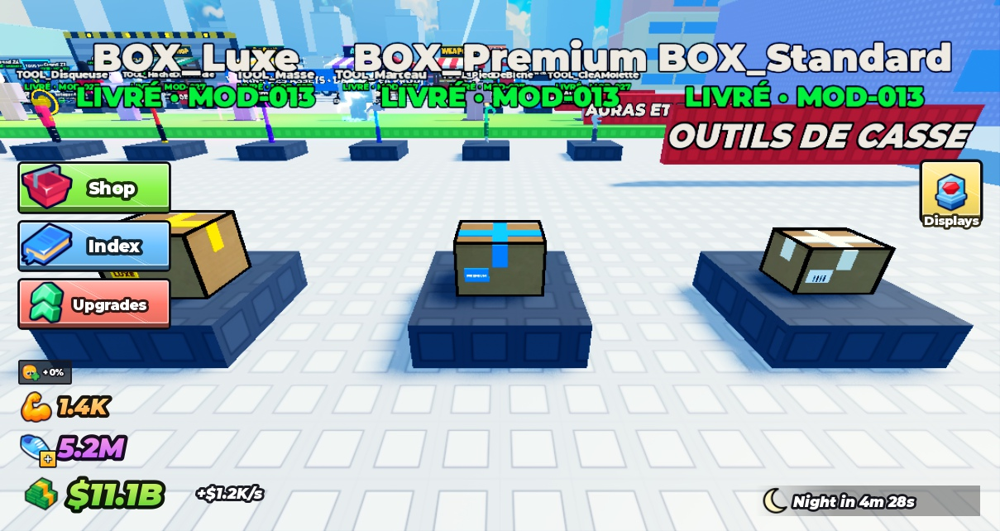

# Direction artistique de référence : les colis (BOX_*)

Relevé du 2026-11-20 dans Studio (place DEV, lecture seule, MCP Roblox Studio), agent `revue-modeles`. Sert de base aux planches (`planches-chatgpt`) et aux prompts 3D (`prompteur-3d`). Règles du doc partagé reprises telles quelles : budgets 10.2, nommage 10.3, contrat 10.4, couleurs des raretés 10.6.

> **Mise à jour du 2026-11-20** : Clément veut les objets exposés en studs et en blocs. Pour eux, cette fiche est remplacée par [DA-objets-studs-blocs.md](DA-objets-studs-blocs.md).

## Ce qui a été mesuré

- **Colis des rayons** : `ReplicatedStorage/Assets/Boxes/BOX_<Rareté>` (Common, Uncommon, Rare, Epic, Legendary, Mythic, Secret, Divine). Vérifié en Play : les 120 `ShelfBox` des 12 magasins portent l'attribut `BoxRarity` et sortent de ces modèles (Common à Legendary sur la carte au moment du relevé).
- **Colis par palier** : `BOX_Standard`, `BOX_Premium`, `BOX_Luxe` (même construction, en carton, avec ruban et étiquette).
- Pour chaque colis : taille, pièces, matériaux, couleurs (hex), triangles (maillages lus avec `EditableMesh`), contours, lumières et particules.

*Colis de la vitrine `_SHOWROOM_CLEMENT/COLIS`. On voit la signature des colis : un bloc simple, des arêtes noires épaisses, une matière texturée (carton) et une seule couleur vive (le ruban).*

Les colis de rareté n'existent en jeu que pendant un Play (posés par le code sur les rayons), et la capture de Studio ne marche qu'en Edit. Ils sont donc décrits ici par leurs mesures. Il faudra une capture en Play (ou un rendu Blender) avant d'envoyer la planche à ChatGPT.

## Les mesures, colis par colis

| Colis | Taille L × H × P (studs) | Pièces visibles | Triangles | Matière de base | Couleur de rareté (Tint) | Effets |
| --- | --- | --- | --- | --- | --- | --- |
| BOX_Common | 1,62 × 0,96 × 1,18 | 8 | 180 | Cardboard `#E0AE70`, rabats `#D4A266` | Ruban SmoothPlastic `#B0B7C3` | — |
| BOX_Uncommon | 1,78 × 0,99 × 1,25 | 10 | 276 | Cardboard `#E8BC80` / `#DDAF72`, poignées `#5A3D22` | SmoothPlastic `#2FE08F` | — |
| BOX_Rare | 1,83 × 1,07 × 1,28 | 8 | 252 | Caisse Wood `#C98A4B`, `#D69A5A`, montants `#9C6332`, `#8A5428` | Cerclage Metal `#2F9BFF` | — |
| BOX_Epic | 1,84 × 1,19 × 1,30 | 7 | 248 | Mallette SmoothPlastic `#2E2748` / `#3B3260`, poignées `#1B1B24`, fermoirs Metal `#C9CDD4` | **Neon** `#A855F7` | PointLight `#A855F7`, 1,0 / 6 studs |
| BOX_Legendary | 1,97 × 1,13 × 1,40 | 6 | 288 | **Foil** `#FFC21A` / `#FFD95A`, coins et serrure Metal `#8C5A14` | Neon `#FFC21A` | PointLight 1,5 / 8, particules 6/s |
| BOX_Mythic | 2,01 × 1,25 × 1,45 | 8 | 272 | SmoothPlastic `#9E1030` / `#B5153A`, bandes et serrure Foil `#FFC21A` | Neon `#FF3B5C` | PointLight 1,6 / 8, particules 7/s |
| BOX_Secret | 2,08 × 1,25 × 1,48 | 7 | 300 | SmoothPlastic `#17112E` / `#221A44` | Neon `#EDE4FF`, marque `#FFFFFF` | PointLight 1,8 / 10, particules 9/s |
| BOX_Divine | 3,17 × 1,62 × 1,48 (ailes comprises) | 8 | 296 | SmoothPlastic `#F7F3EA` / `#FFFFFF`, liserés et ailes Foil `#FFC21A` / `#FFD95A` | Neon `#FFE9A8`, halos `#FFE38A` | PointLight 2,2 / 12, particules 12/s |
| BOX_Standard | 1,64 × 1,04 × 1,17 | 13 | ≈ 160 (Parts + 1 Union) | Cardboard `#E0AE70` / `#D4A266` | Ruban `#F6EED6`, étiquette `#FAFAFA`, code-barres `#1E1E1E` | — |
| BOX_Premium | 1,79 × 1,19 × 1,31 | 9 | ≈ 120 | Cardboard | Ruban et pastille `#2E86DE` (texte « PREMIUM ») | — |
| BOX_Luxe | 1,94 × 1,39 × 1,51 | 9 | ≈ 120 | Cardboard | Ruban et pastille `#FFC21A` (texte « LUXE ») | — |

Points communs à tous :

- `OutlineHighlight` (Highlight) : FillTransparency 1, OutlineColor `#000000`, OutlineTransparency 0, DepthMode Occluded.
- `Outline` : Part invisible (Transparency 1, CastShadow coupé) de la taille du colis plus 0,02 stud, qui porte une SelectionBox `OutlineBox` noire de **0,025 stud** d'épaisseur. Elle dessine les arêtes, même quand le Highlight est coupé (le code n'en garde que 20 actifs, `ShelfBoxController`).
- `Lid` : Model à part (rabats `FlapL` / `FlapR`, ou couvercle) ; `Body` porte `CarryAttachment` et `LabelPoint` ; `Tint` est la pièce à la couleur de la rareté (contrat 10.4).
- Le corps (`Body`) de `BOX_Common` fait **12 triangles** : un pavé sans biseau. Le relief vient de pièces posées dessus (rabats de 0,08 stud, ruban de 0,02, étiquette de 0,02, encre de 0,01), pas de chanfreins ni de sculpture.

## La DA en règles chiffrées

### 1. Silhouette : un bloc, lisible de loin

- Une forme principale simple (pavé, cylindre, sphère aplatie) qui remplit **au moins 70 %** de la boîte englobante. Les colis font L:H:P ≈ **1,6 : 1 : 1,2**.
- Arêtes vives, **pas de biseau** sur le volume principal. Le relief se fait par plaques et bandes ajoutées.
- Épaisseur minimale d'une pièce qui dépasse : **0,08 stud** (rabats). Les aplats posés à plat sur une face (ruban, étiquette, encre) peuvent descendre à 0,01–0,02 stud, car ils ne changent pas la silhouette.
- Aucune partie fine qui porte la forme : pas de tige, de chaîne ou de treillis à moins de **0,15 stud**. Si l'objet réel est fin (chaîne, lunettes, carte), on le grossit ou on le pose sur un support plein.
- Test : l'objet se reconnaît en silhouette noire à 40 studs et en icône de 64 px (10.1).

### 2. Contour noir

- Toutes les arêtes extérieures sont cernées de noir `#000000`. Sur les colis : arêtes en SelectionBox de 0,025 stud, plus le Highlight `OutlineHighlight`.
- Pour une forme qui n'est pas un pavé (la plupart des objets), une SelectionBox ne suit pas la forme et le Highlight est limité à 31 à l'écran. **Proposition** à valider par Clément et Ironix : contour dans le maillage (coque inversée noire de 0,03 stud, normales retournées, faite dans Blender). Ça coûte environ 2 fois les triangles de l'objet, ce qui reste dans le budget 10.2 (objets autour de 300 triangles aujourd'hui, budget 2 000).

### 3. Couleurs : peu, et franches

- **4 à 6 teintes** par modèle (les colis en ont 4 à 7, noir du contour compris).
- Répartition : 1 à 2 teintes de matière (corps et rabats, écart de valeur de 5 à 10 %, par exemple `#E0AE70` et `#D4A266`) ; **1 couleur de rareté** exacte, celle de `Rarities.luau` ; 1 à 2 neutres pour les détails (`#FAFAFA` blanc étiquette, `#1E1E1E` encre, `#1B1B24` ferrures sombres).
- Le noir pur `#000000` sert seulement au contour.
- L'or est **`#FFC21A`** (clair `#FFD95A`, foncé `#8C5A14`). Les ors `#E8B830`, `#F2C230`, `#D4AC3C`, `#D6B250` relevés ailleurs ne sont pas ceux des colis.

### 4. Matériaux

- Base dans un matériau Roblox **texturé** qui dit ce qu'est l'objet : Cardboard (carton), Wood (caisse), Foil (or), plus SmoothPlastic pour les aplats de couleur.
- Metal seulement pour la quincaillerie (serrure, fermoirs, coins), 2 pièces au plus.
- **Neon : une seule pièce, et seulement à partir d'Épique** (la bande `Tint`). Pas de néon sur un Commun, un Peu commun ou un Rare.
- Jamais sur un colis : Plastic (studs), Glass, SurfaceAppearance (PBR), Decal ou Texture.

### 5. La rareté se lit à la matière, puis à la lumière

| Rareté | Matière | Couleur de rareté | Lumière | Particules |
| --- | --- | --- | --- | --- |
| Commun | Carton mat | Ruban gris `#B0B7C3` | aucune | aucune |
| Peu commun | Carton mat + poignées | Bande menthe `#2FE08F` | aucune | aucune |
| Rare | Bois (caisse) | Cerclage Metal bleu `#2F9BFF` | aucune | aucune |
| Épique | Mallette sombre + Metal | Néon violet `#A855F7` | 1,0 / 6 studs | aucune |
| Légendaire | Foil or | Néon or `#FFC21A` | 1,5 / 8 | 6/s |
| Mythique | Rouge sombre + Foil or | Néon `#FF3B5C` | 1,6 / 8 | 7/s |
| Secret | Violet nuit | Néon blanc lilas `#EDE4FF` | 1,8 / 10 | 9/s |
| Divine | Blanc + Foil or, ailes | Néon crème `#FFE9A8` | 2,2 / 12 | 12/s |

- La taille monte d'environ 4 % par palier (largeur de 1,62 à 2,08 studs, puis 3,17 avec les ailes du Divine).
- Ça reprend le langage de 10.6 : Commun mat, Rare un peu brillant, Épique avec un accent néon, Légendaire doré.

### 6. Budget et construction

- Colis : **180 à 300 triangles** (budget 10.2 : 300), de 6 à 10 pièces visibles, en MeshPart.
- Objets exposés : même ordre de grandeur visé (300 à 800 triangles, contour compris), très en dessous de 2 000 / 4 000.
- Couvercle séparé (`Lid`) et pièce `Tint` recolorable : on peut changer de rareté sans remodeler.

## À faire / à ne pas faire

| À faire | À ne pas faire |
| --- | --- |
| Un volume plein et simple, arêtes vives | Tiges, chaînes, treillis, pièces de moins de 0,15 stud qui portent la forme |
| Contour noir sur toutes les arêtes extérieures | Compter sur l'ombre ou l'éclairage pour détacher la forme |
| 4 à 6 teintes, dont une seule couleur de rareté exacte | 8 à 10 teintes, gris foncés partout, couleurs Roblox par défaut (`#4B974B`, `#0D69AC`) |
| Matière texturée qui dit l'objet (carton, bois, or Foil) | Tout en SmoothPlastic uni, ou en Glass transparent |
| Or `#FFC21A` en Foil à partir de Rare | Or ocre `#E8B830` ou `#F2C230` en SmoothPlastic |
| Néon sur une seule pièce, à partir d'Épique | Néon sur un Commun, ou un objet tout en néon |
| Détails en plaques posées sur les faces | Détails peints en texture ou sculptés en creux |
| Lumière et particules réglées par palier (tableau 5) | Feuillage ou matériaux PBR réalistes (SurfaceAppearance) |

## Phrase de style pour les prompts

> Objet de jeu Roblox cartoon low-poly façon colis : un volume simple et plein, arêtes vives sans biseau, contour noir épais sur toutes les arêtes, 4 à 6 couleurs franches dont une seule couleur de rareté, détails en plaques posées sur les faces, matière lisible (carton, bois, or brillant), pas de parties fines, lisible à 40 studs et en icône de 64 px.
