# Boutique du joueur : une base carrée au départ (2026-11-21)

Demande de Clément : « revoir la base pour que la taille de notre boutique soit un carré de base ».
Backlog : MOD-015 / MOD-016 (boutique du joueur, voir `boutique-joueur-MOD-015-016.md`). Liaison liée : L-096, L-141, L-190, L-217, L-228, L-239, T-111.

**Statut : option A validée par Clément (« Oui, fais A », 2026-11-21) et faite dans Studio (place DEV, non enregistrée, rien publié). Places 5 à 12 vides au départ (choix par défaut). Reste le réglage d'Ironix (section 4).**

## 1. Ce qu'il y a aujourd'hui (Studio DEV, lu le 2026-11-21)

- **6 parcelles** `PLOT_Shop_01` à `_06` dans `Workspace/Map/Hub/Shops`, tag `PlayerPlot`, chacune avec `PlotIndex`, `AssignOrder` et `AccentColor` :

  | Parcelle | Pivot (x ; z) | Rotation | `AssignOrder` |
  | --- | --- | --- | --- |
  | `_01` | (−32 ; 189) | 0° | 5 |
  | `_02` | (−106 ; 88,5) | −90° | 3 |
  | `_03` | (−106 ; 29,5) | −90° | 1 |
  | `_04` | (−106 ; −29,5) | −90° | 2 |
  | `_05` | (−106 ; −88,5) | −90° | 4 |
  | `_06` | (−32 ; −189) | 180° | 6 (le bot) |

  Les 4 du milieu sont espacées de 59 studs (6 studs de passage entre deux boutiques, L-228). Le fond des boutiques `_02` à `_05` touche presque le grand mur du hub (fond en x −146, mur en x −149).
- **Gabarit** : `ReplicatedStorage/Assets/Plots/PLOT_Shop`, `RowCut = true`. Repère : porte en z −40 (avant vers −Z), fond en z 40.
- **Enfants** (gabarit et hub) : `Bounds` 48 × 29,7 × 80, `DepositZone` 47,4 × 12 × 79, `PlotFloor` **48 × 24** (z −40 à −16), `FloorTiles`, `PlotBarrier`, `PlotDoor`, `RarestDisplay`, `Rayon_01` à `_05`, `Stage_1`, `Treadmill`, `VaultAnchor`, `CashPad`. Le gabarit a en plus `Stage_2` à `Stage_5` (le code les copie dans la boutique selon le niveau).
- **Présentoirs** : 2 files en x ±16, un rang tous les 7 studs, z −32, −25, −18, −11, −4, 3, 10, 17, 24, 31 (`DisplaySlot_01` à `_20`, 2 par rang). Le joueur commence avec **4 présentoirs** et peut monter à 20 (`Config/Upgrades`, `DisplaySlots`).
- **Empreinte au départ : 48 de large × 24 de profondeur**, un rectangle deux fois plus large que profond. Les parcelles `PLOT_Greybox_*` de `ServerStorage/_GREYBOX_REMPLACE` (64 × 80) ne servent plus.

### Comment la boutique grandit aujourd'hui (code `ShopStageService`, `Config/ShopGrowth`)

Fond = z du dernier rang débloqué + 5, arrondi au plan suivant parmi −16, −12, −4, 4, 8, 16, 24, 32, 40 (plans figés de la découpe L-190, ne pas les changer sans recouper).

| Présentoirs | Fond (z) | Empreinte |
| --- | --- | --- |
| 4 (départ) | −16 | 48 × 24 |
| 5-6 | −12 | 48 × 28 |
| 7-8 | −4 | 48 × 36 |
| 9-10 | 4 | 48 × 44 |
| **11-12** | **8** | **48 × 48 : carré** |
| 13-14 | 16 | 48 × 56 |
| 15-16 | 24 | 48 × 64 |
| 17-18 | 32 | 48 × 72 |
| 19-20 | 40 | 48 × 80 |

Au niveau 1 (rayon 1 seul), seul `Stage_1` est là : le cadre solide de L-239 (socle, colonnes, corniche, vitres, et le fond `Frame/Back_L1`, `HideFromStage = 2`), sur z −40 à −16. `PlotBarrier` a aussi ses pièces du niveau 1 (`Barrier_L1`, `_R1`, `_B1`, `_Lid1`, `HideFromStage = 2`).

Captures de l'état actuel (Edit, niveau 1) :

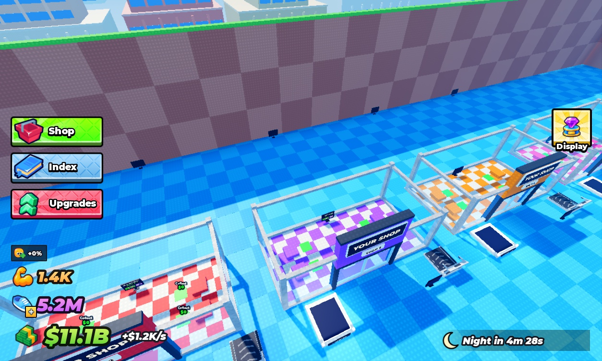
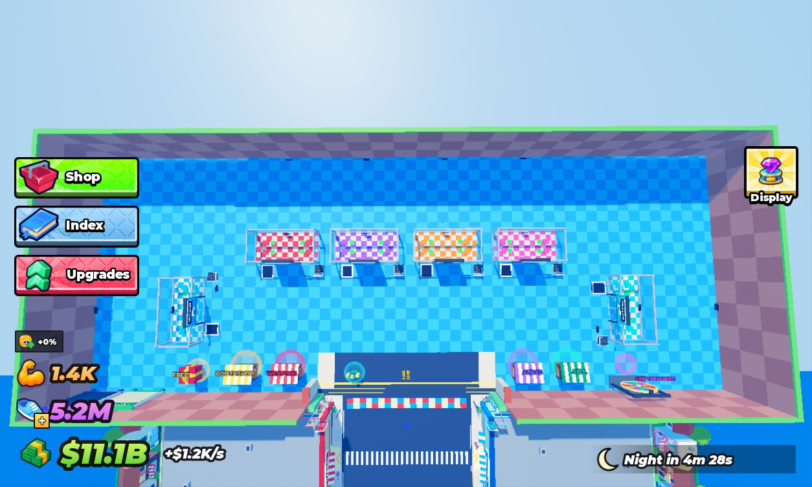

## 2. Ce que le code attend (lecture seule de `src/`)

- Tout se lit **dans le gabarit**, par nom : positions des `DisplaySlot_xx`, des `StageUpgradePoint` et du fond. Aucune largeur ni profondeur de boutique écrite en dur dans `ShopStageService`, `RayonService`, `ShopWallsService` ou `PlotService` (seul `PlotService` prend `centre + avant × 40` quand il n'y a pas de porte).
- `Config/ShopGrowth` : `RowMargin = 5`, `Step = 4`, `StepOrigin = −40`, **figés** (L-190). Le fond le plus proche possible est z −16.
- `Bounds` et `DepositZone` gardent la taille entière (48 × 80) dès le niveau 1 : vol, PvP, bot, inventaire au sol et témoins lisent `Bounds`, rien ne change pour eux.
- Ce qui casserait si on agrandissait seulement les modèles : à 5 à 10 présentoirs, le code poserait le fond (mur du fond, parapet, caméras, qui avancent avec lui) en z −12, −4 ou 4, **au milieu** du carré de départ. Il faut donc un petit réglage d'Ironix (section « Pour Ironix »).
- Les `StageUpgradePoint` sont des Attachments de `PlotFloor` : redimensionner `PlotFloor` les déplacerait. Ma proposition laisse `PlotFloor` tel quel.

## 3. Proposition

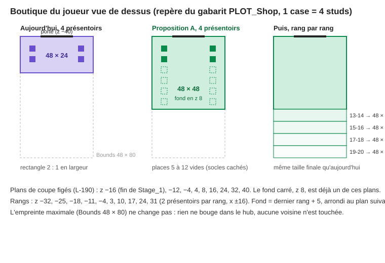

### A. Carré de 48 × 48 au départ, puis la boutique s'allonge comme aujourd'hui (ma recommandation)

- **Départ : 48 × 48** (porte en z −40, fond en z 8). C'est la taille qu'on a aujourd'hui à 11-12 présentoirs, et z 8 est déjà un plan de la découpe.
- Les 4 premiers présentoirs restent où ils sont (près de la porte). Les places 5 à 12 sont dans la boutique mais vides : leurs socles restent cachés tant qu'ils ne sont pas achetés, comme aujourd'hui.
- **Ensuite** : rien ne bouge jusqu'à 12 présentoirs, puis la boutique s'allonge comme aujourd'hui : 48 × 56 à 13-14, 64, 72, puis 48 × 80 à 19-20.
- **Hub et voisines** : l'empreinte maximale (`Bounds` 48 × 80) ne change pas, donc aucune parcelle ne bouge et aucune voisine n'est touchée. La boutique de départ est juste plus profonde, vers le mur du fond.
- **Côté modèles (moi, après accord)** :
  1. ranger dans `Stage_1` les tronçons de `Stage_2` qui sont entre z −16 et z 8 (sol `PlotFloorExt`, `FloorTilesExt`, côtés du cadre `Frame`), avec les mêmes noms. Ils ne sont pas copiés en double : ils changent juste de parent. Vérifié : aucune pièce de `Stage_2` ne traverse z 8, et entre z −16 et 8 il y a 4 `PlotFloorExt`, 36 `FloorTilesExt` et 18 `Frame` à déplacer (les 9 `Barriers` et les 28 `RayonSpots` restent dans `Stage_2`) ;
  2. reculer le fond du niveau 1 (`Stage_1/Frame/Back_L1`) et le fond du champ de force (`PlotBarrier/Barrier_B1`) de z −16 à z 8, et allonger `Barrier_L1`, `_R1` et `_Lid1` de 24 à 48 (ils gardent `HideFromStage = 2`) ;
  3. faire la même chose sur les 6 `PLOT_Shop_0n` du hub (même pivot, mêmes attributs), sans rien renommer et sans script. `PlotFloor`, `Bounds`, `DepositZone`, les `DisplaySlot` et les points d'achat ne bougent pas.
- Les murs (`Stage_3`) et la verrière (`Stage_4`) arrivent toujours avec leur niveau ; au niveau 1, le carré a le cadre solide de L-239 sur tout son tour.

### Les autres façons, que je ne recommande pas

- **B. Un carré qui grandit en restant carré** (48 → 64 → 80 de côté) : il faudrait élargir la boutique et ajouter des files de présentoirs, alors que les 4 boutiques du milieu n'ont que 6 studs entre elles (pivots à 59 studs). Il faudrait refaire tout le hub (L-228) et la mise en page de L-141.
- **C. Un carré fixe de 48 × 48** qui ne s'allonge plus : il faut y faire tenir 20 présentoirs, donc 4 files au lieu de 2 ; l'allée centrale de L-141 disparaît, et toute la découpe L-190 est à refaire.

### Questions pour Clément

1. **A** te va (carré de 48 × 48 au départ, puis la boutique s'allonge jusqu'à 48 × 80) ?
2. Les places 5 à 12, vides au départ : tu les veux vides (sol seul), ou avec un marquage au sol « à acheter » (contours `RayonSpot`, déjà dans `Stage_2/RayonSpots`) ? Par défaut : vides.

## 4. Pour Ironix (à reporter dans la liaison par la session principale)

À faire seulement si Clément valide A ; à livrer en même temps que les modèles, sinon le mur du fond arrive au milieu de la boutique entre 5 et 10 présentoirs.

- **`Config/ShopGrowth`** : ajouter un fond minimum, par exemple `MinBack = 8` (z dans le repère du gabarit ; nom V0 à choisir) : fond = max(fond calculé, `MinBack`). Les plans de L-190 ne changent pas.
- **`ShopStageService`** : appliquer ce minimum dans le calcul du fond, `StageDepth` compris (le panneau `StageUpgradePoint_2` suit déjà le fond). Au niveau 1, rien ne change : `Stage_1` n'est jamais coupé.
- **Rien d'autre à changer à ma connaissance** : `Bounds`, `DepositZone`, `PlotFloor`, `DisplaySlot_xx`, `AssignOrder` et le hub restent identiques.
- **Démarrage du serveur** : « Script timeout » dans le Loader à chaque Play (voir section 5) ; `RayonService` ne pose alors rien sur la boutique du joueur.
- **À retester** : T-111 (achat des présentoirs de 4 à 20, raccords du fond), avec en plus : le carré au départ, et pas de mur au milieu à 5-10 présentoirs.

## 5. Fait dans Studio (2026-11-21)

- **Sauvegarde** : `ServerStorage/MapBackups/2026-11-21_BoutiqueCarree` (le gabarit `PLOT_Shop` et les 6 `PLOT_Shop_0n` d'avant). Les tags ont été retirés des copies (gardés dans l'attribut `OrigTags`, chemin dans `OrigPath`) pour que `PlayerPlot` ne compte pas 13 parcelles.
- **Script** (rejouable, ne refait rien si c'est déjà fait) : `tools/clement/zones/boutique_base_carree.luau`.
- **Gabarit `ReplicatedStorage/Assets/Plots/PLOT_Shop`** : 64 tronçons de `Stage_2` (z −16,4 à 8) passés au niveau 1 avec le même nom : 4 `PlotFloorExt` dans `Stage_1`, 36 carreaux de `FloorTilesExt` dans `FloorTiles`, 24 côtés (`Plinth_L/R`, `Cornice_L/R`, `Pane_L/R`) dans `Stage_1/Frame`. `Stage_1/Frame/Back_L1` et `PlotBarrier/Barrier_B1` reculés de 24 studs (fond en z 8) ; `Barrier_L1`, `_R1` et `_Lid1` passent à 48 de long. `HideFromStage` n'a pas changé.
- **Hub** : les mêmes 64 pièces copiées dans chacune des 6 boutiques (même pose, couleur `AccentColor` de la boutique sur les pièces `Accent`), avec le même recul du fond. Rien n'est renommé, aucun script ; `PlotFloor`, `Bounds`, `DepositZone`, `DisplaySlot_xx`, les points d'achat, `PlotIndex` et `AssignOrder` sont inchangés.
- **Vérifié** : niveau 1 de 48 × 48 (z −40 à 8) partout ; en Play, `ShopStageService.Apply` appelé à la main sur `PLOT_Shop_04` à 4, 6, 14 et 20 présentoirs : fond en z 8, −12, 16, puis la boutique entière, et à 20 présentoirs aucune pièce visible en double. ContractChecker lancé en Edit : « Contrat : OK », aucune ligne rouge, rien de nouveau sur les parcelles.
- **Vu en Play à 6 présentoirs** : comme prévu, tant que le fond minimum d'Ironix n'est pas codé, le mur du fond de `Stage_2` se met en z −12, au milieu du carré (capture ci-dessous). Ça disparaît avec `MinBack`.
- **Pas vu** : la boutique d'un vrai joueur qui grandit en Play. Les deux Play ont fini sur « Script timeout: exhausted allowed execution time » dans `ReplicatedStorage.Shared.Loader` (ligne 83, `Main:8`), juste après `RebirthService`. Ensuite `RayonService` n'a rien posé (`StageLevel` absent ; la boutique du joueur, à 19 présentoirs, restait au niveau 1 avec des objets qui flottaient au-dessus du hub). C'est le même message que dans `WitnessService` (a269g, Play f81f). Ma retouche ajoute 384 pièces aux 86 000 du Workspace : c'est peu probablement la cause, mais je ne l'ai pas prouvé en revenant en arrière. **À regarder par Ironix.**

Captures :

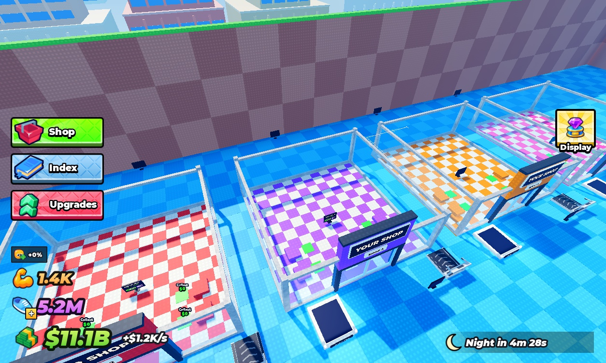
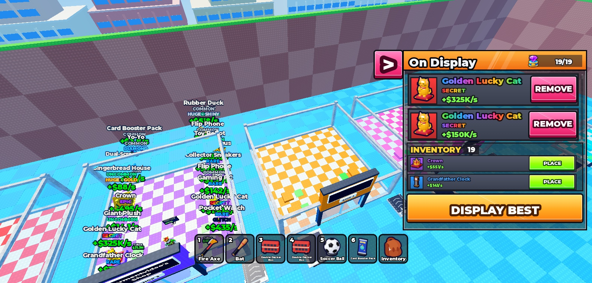
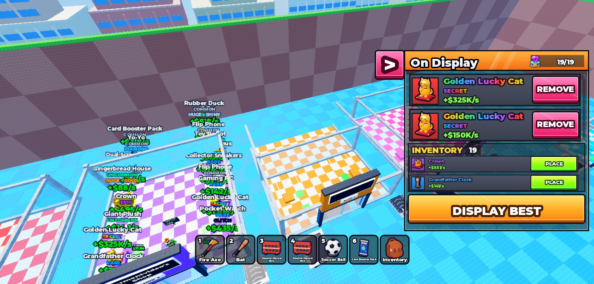
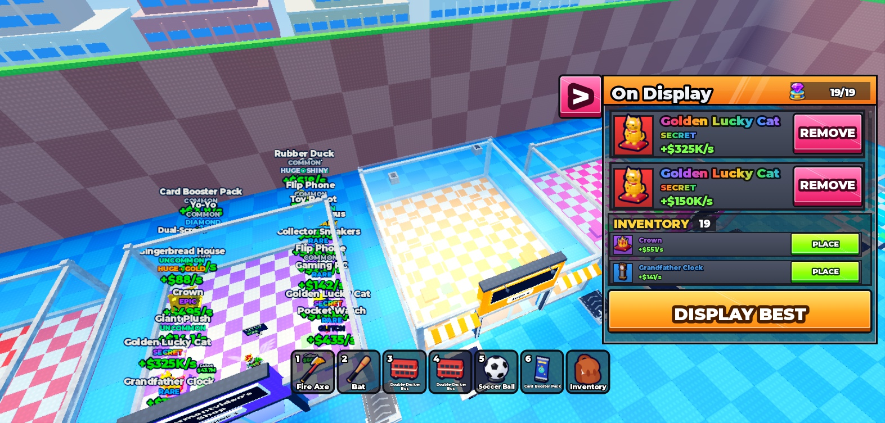
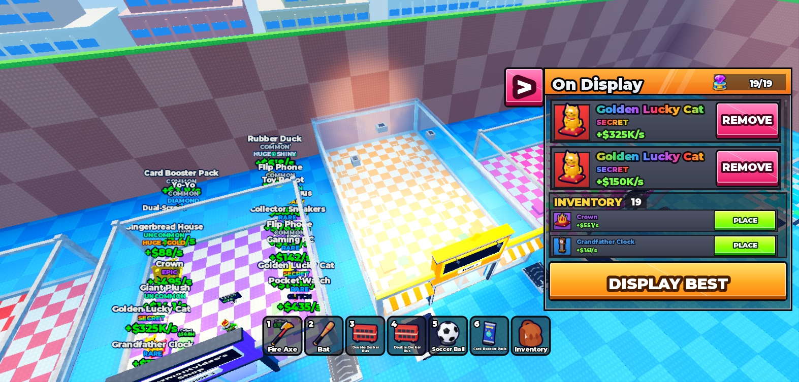

Pour revenir en arrière : remettre les 7 modèles de la sauvegarde à leur `OrigPath` et leur rendre leurs tags (`OrigTags`).

## 6. Panneau de la boutique au fond, tapis écarté (proposition, 2026-11-21)

Demande de Clément : « Mets le panneau d'amélioration de la boutique au fond de la boutique, écarter le treadmill de la boutique avec son panneau d'amélioration car là c'est trop près. » **Validé par Clément (« Oui, 10 studs », 2026-11-22) et fait dans Studio : voir 6.1.**

### Ce que le code fait déjà (lecture seule, `UpgradeController`, `ShopStageService`)

- Le panneau « Display Stands » (agrandir la boutique) se pose sur `StageUpgradePoint_n`, avec n le plus grand sans dépasser le niveau de la boutique (`StageLevel`), sinon sur `StageUpgradePoint`. `DisplayUpgradePoint` ne sert que s'il n'y a ni l'un ni l'autre.
- **Niveaux 2 à 5 : c'est déjà au fond.** `StageUpgradePoint_2` est en z 37,6 dans le gabarit (2,4 studs devant le fond) et le serveur l'avance avec le fond (`StageDepth`). Avec `MinBack = 8`, il ne passera jamais devant z 5,6.
- **Niveau 1 : il est au milieu.** `StageUpgradePoint` est en (0 ; 0,3 ; −18,6), au milieu du nouveau carré. C'est un point de Clément : il suffit de le reculer, **sans code**.
- Le tapis est retrouvé par son tag `Treadmill` dans la boutique, et son panneau par l'Attachment `Treadmill/Frame/UpgradePoint`. Le déplacer avec la boutique comme parent ne demande **pas de code**.

### Proposition

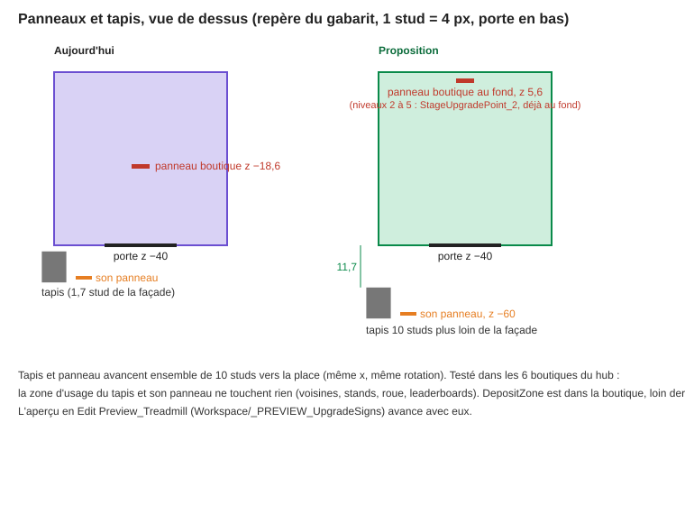
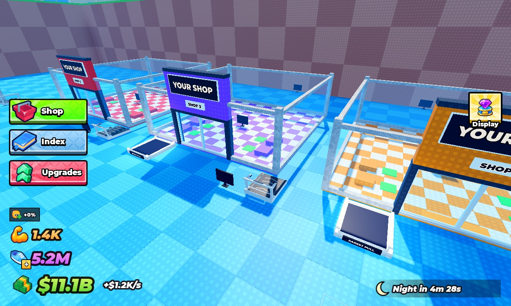

1. **Panneau de la boutique** : `PlotFloor/StageUpgradePoint` passe de z −18,6 à **z 5,6**, contre le mur du fond du carré (même écart au fond que `StageUpgradePoint_2`), toujours tourné vers la porte. L'aperçu `Preview_ShopUpgrade` suit. `DisplayUpgradePoint` ne bouge pas (il ne sert qu'en secours).
2. **Tapis et son panneau** : le modèle `Treadmill` entier (zone d'usage et `UpgradePoint` compris) avance de **10 studs** vers la place, sans tourner ni changer de x : il passe de 1,7 à 11,7 studs de la façade, et son panneau de z −50 à z −60. L'aperçu `Preview_Treadmill` suit. Testé dans les 6 boutiques : à cette place, la zone d'usage et le panneau ne touchent ni les voisines, ni les stands, ni rien d'autre du hub. `DepositZone` est dans la boutique, loin derrière.

**Question pour Clément** : 10 studs de plus, ça te va, ou tu veux plus près (6) ou plus loin ?

### 6.1 Fait dans Studio (2026-11-22)

- **Sauvegarde** : `ServerStorage/MapBackups/2026-11-22_PanneauxTapis` (gabarit, 6 boutiques et `_PREVIEW_UpgradeSigns`, état d'après la 1re partie ; tags retirés des copies et gardés dans `OrigTags`).
- **Script** : 2e partie de `tools/clement/zones/boutique_base_carree.luau` (rejouable). J'ai aussi retiré le `return` qui terminait la 1re partie, pour qu'on puisse coller le fichier en entier.
- **Gabarit et 6 boutiques** : `PlotFloor/StageUpgradePoint` est en (0 ; 0,3 ; 5,6) et garde son orientation vers la porte. Le modèle `Treadmill` entier est avancé de 10 studs : sa structure est en z −56 et son `Frame/UpgradePoint` en (−15,6 ; −60). Les aperçus `Preview_ShopUpgrade` et `Preview_Treadmill` ont suivi. Aucun nom n'a changé et je n'ai laissé aucun script.
- **Vérifié** : à sa nouvelle place, la zone d'usage du tapis (avec son panneau) ne touche rien dans les 6 boutiques. En Play, ce Play-là, le serveur a démarré sans « Script timeout » (le code a été mis à jour entre-temps) et le contrat est OK. Le panneau du tapis se pose en (−15,6 ; −60), et le joueur monte bien sur le tapis (`TrainingService`). Le panneau « Display Stands » se pose en z 37,6 quand la boutique est entière (niveau 5), puis en **z 5,6** après `ShopStageService.Apply(plot, 1, 4)`, qui la remet au niveau 1.
- **Pas vu par Claude** : le rendu, c'est-à-dire si le panneau du fond se lit bien depuis la porte (45 studs) et si le tapis plus loin est agréable à utiliser. C'est à juger en jeu par Clément.

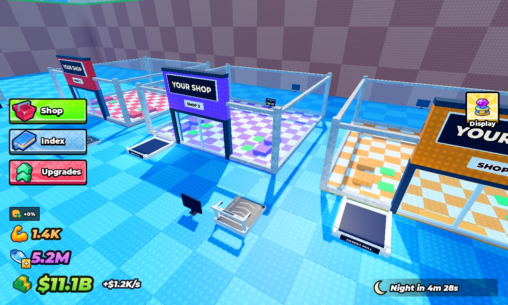
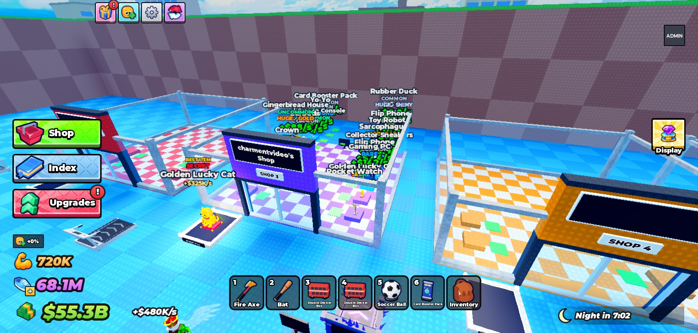
