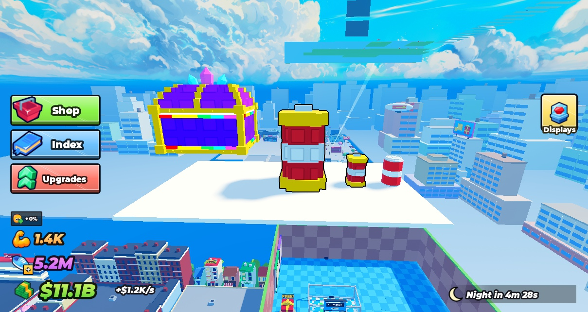
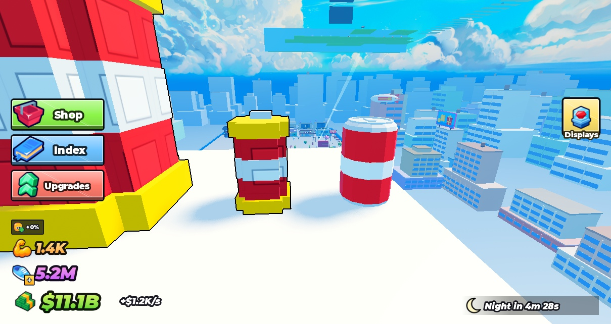

# Exemple : la canette de soda dans le style de l'Exclusive Crate

Le 2026-11-20. Le but est de comparer deux façons de faire un objet exposé dans le style du nouveau colis `BOX_Shop_ExclusiveCrate` : des studs sur les grandes faces, et un cadre lisse sur les bords.

## Version Studio (en Parts) : faite

- Script : [canette_studio.luau](canette_studio.luau). Lancé en Edit, il a créé `Workspace/_EXEMPLE_STUDS` (à y = 200, loin de la carte). Rien d'autre n'a été modifié, et la place n'a pas été enregistrée.
- Contenu du dossier, de gauche à droite : l'ancienne canette (maillage lisse), la nouvelle à la taille du jeu (1 × 1,75 stud), la même à × 2,5, puis le colis de référence.
- La canette compte 11 Parts (12 triangles chacune, soit environ 130 triangles). Le corps rouge et la bande blanche sont en Plastic + `Studs`, les bords en or `#FFC21A` en SmoothPlastic, et elle a le contour noir `OutlineHighlight`.

Ce qu'on voit :
- **Ça va avec le colis.** Grâce au cadre or et au contour noir, la canette × 2,5 a la même allure que l'Exclusive Crate.
- **Les studs du jeu sont des carreaux en relief, pas des picots ronds.** À la taille du jeu, on voit environ un carreau par face. C'est lisible, mais un peu gros. Plus l'objet grandit avec son poids, plus on en voit.
- **La forme en « deux pavés croisés » fait une canette à huit pans.** De face, elle se lit, mais les bords en escalier se voient (le coin des rebords or). Un vrai cylindre à 12 pans serait plus propre : soit avec une Part `Cylinder`, soit en maillage.
- **Les bords ne sont pas réglés au pas.** Le haut (0,25 + languette) dépasse un peu de `Root`. À régler si on garde cette méthode.

## Version maillage (Claude Design) : à générer

- Prompt : [canette_claude-design.md](canette_claude-design.md). C'est la même méthode que l'Exclusive Crate : des MeshPart séparées, et le matériau `Studs` posé dans Studio sur `Body` et `Band`.
- Blender n'est pas installé sur ce PC (il ne reste que le dossier `Blender 4.4`, sans le programme). Il faut donc passer par Claude Design. Quand le `.glb` arrive, on le vérifie (taille, triangles, noms), puis on le pose dans `_EXEMPLE_STUDS` à côté de la version Studio.

## Ce qu'il faut décider après la comparaison

1. Méthode : en Parts dans Studio (rapide, à peine une centaine de triangles, mais des formes en escalier), ou en maillage avec Claude Design (formes plus propres, mais un import à chaque objet) ?
2. Cadre or sur tous les objets, ou seulement à partir d'une certaine rareté (Commun en gris, par exemple) ?
3. Supprimer `_EXEMPLE_STUDS` une fois la décision prise.
